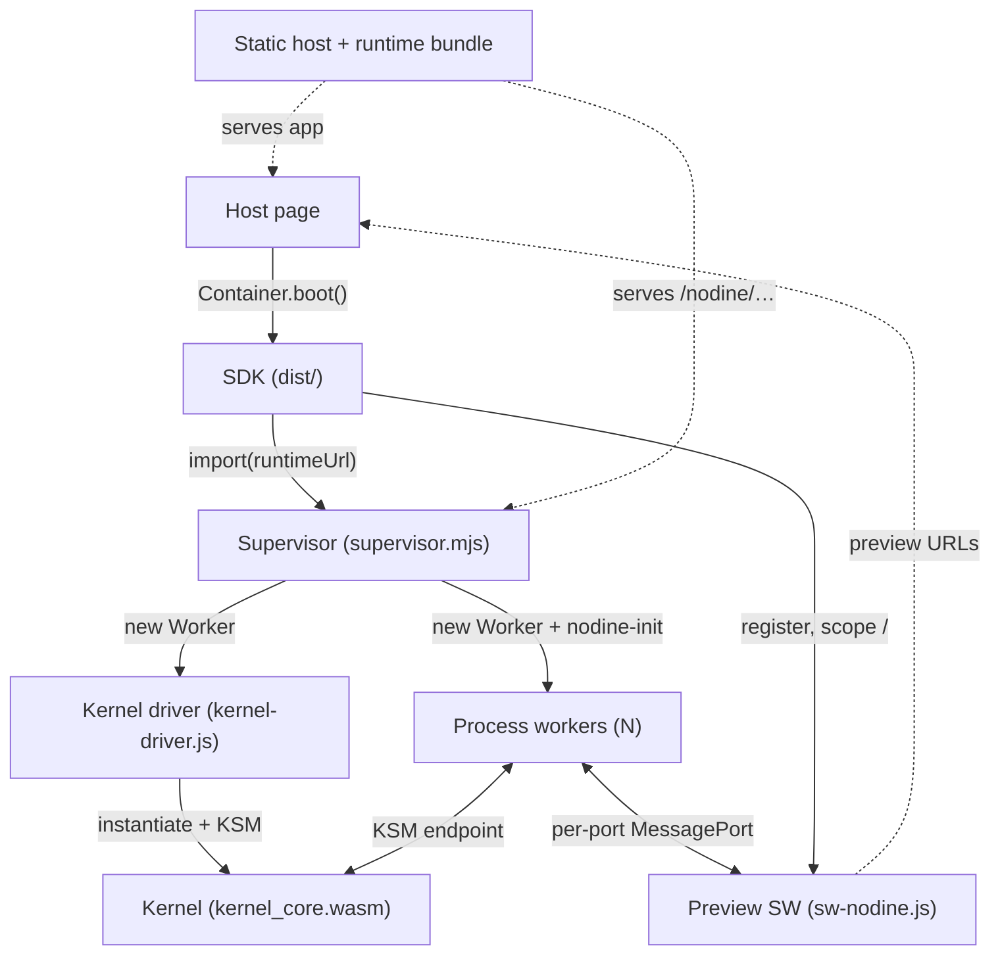
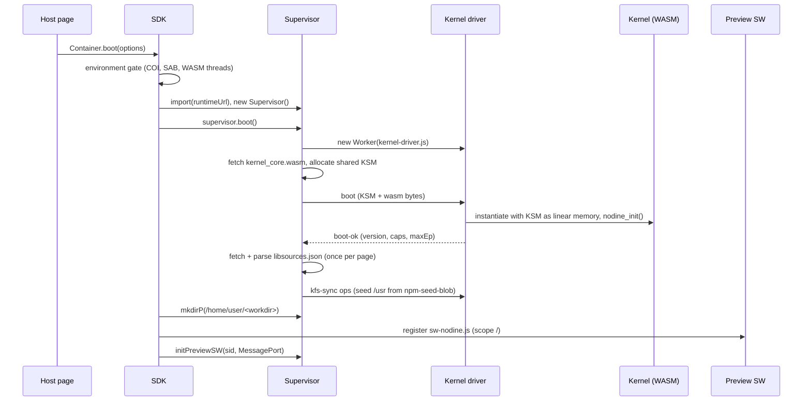

# Architecture

`nodine` is one npm package shipping two artifact groups: the **API SDK** (TypeScript sources in `src/`, compiled to `dist/`) and the **runtime bundle** (the static file tree in `runtime/`: a page-side supervisor, a Rust/WASM microkernel, one Web Worker per process, a preview service worker, the vendored Node.js v26.13.0 library sources, and a complete `/usr` filesystem image). The host page imports only the SDK; every runtime file is fetched or instantiated over HTTP at boot from wherever the host serves the bundle.

This document is the component map: the layer model, how components locate each other, the shared-memory model, the kernel and its frozen ABI, every file in `runtime/` and where it comes from, and the three integration surfaces. API usage lives in the [README](../README.md); the kernel wire contract lives in [`kernel/KERNEL_ABI.md`](../kernel/KERNEL_ABI.md); the supervisor↔driver↔worker message protocol lives in [`runtime-worker-contract.md`](runtime-worker-contract.md).

## Component graph



The solid chain is control flow at boot: the page boots the SDK, the SDK loads the supervisor, the supervisor starts the kernel driver worker (which instantiates the kernel over the shared memory), then spawns one module worker per process. The preview service worker is registered by the SDK and exchanges `MessagePort`s with both the supervisor and the process workers. The static host is not code — it is the file and header surface every other layer is loaded from.

## The layer model

### Host page

The integrating application. It imports `Container` from `nodine`, boots it, and drives the container through the SDK: mount files, `spawn()` processes, read and write through `container.fs`, subscribe to `onOutput` (raw terminal text of all processes) and the `server-ready` / `port` / `preview-message` events. The page loads no runtime code itself — only the SDK chunk, which its own bundler includes. It is responsible for serving conditions, not code: the document must arrive cross-origin isolated (COOP/COEP headers) on a secure context, because the runtime requires `SharedArrayBuffer` and WASM threads. The page also decides where the bundle lives via `BootOptions.runtimeUrl` (default `/nodine/supervisor.mjs`, the path the official Vite plugin and `nodine-stage` produce).

### SDK — `src/` → `dist/`

The public API surface, compiled from TypeScript by `tsc` and imported as `nodine` (entry `dist/index.js`; the plugin entry is `nodine/vite` → `dist/vite.js`). It exports `Container` (`boot`/`spawn`/`fs`/`mount`/`onOutput`/`on`/`teardown`), the error classes, and the shared types. Its job is adaptation, not runtime logic: `boot()` first runs the environment gate (`src/environment.ts`: cross-origin isolation, `SharedArrayBuffer`, service workers, WebAssembly, WASM threads/atomics — a failing check throws `EnvironmentUnsupportedError` before anything is loaded). It then dynamically imports the supervisor module from `runtimeUrl`, validates that it exports a `Supervisor` with the expected method surface (`src/runtime-adapter.ts`), and wraps it: `spawn()` rides a synthetic-parent `MessageChannel`, the filesystem API (`src/fs-adapter.ts`) calls the supervisor's kernel-backed helpers, and the supervisor's terminal output is fanned out through a headless sink to `onOutput` subscribers. The SDK also registers the preview service worker, opens its bridge, and maps supervisor preview events onto the public event API. One instance per page: a second `boot()` before `teardown()` throws.

### Supervisor — `runtime/supervisor.mjs`

A page-side ES module that runs on the main thread, loaded by the SDK via `import(runtimeUrl)`. It owns everything process-shaped: kernel boot (start the driver worker, fetch `kernel_core.wasm`, allocate the shared memory, verify the kernel came up), VFS seeding (stream the `/usr` image from `npm-seed-blob` into the kernel, write the demo workspace), and the exec rules — PATH search over the kernel VFS, symlink resolution, the `node` self-stub (`-v`/`-e`/`-p`), shebang reads, then either a Node worker (`.js`/`.mjs`/`.cjs` or a `#! node`-family script) or exit 127/126. It tracks the process tree (spawn, `signalTree` for SIGTERM/SIGKILL/SIGINT, exit handling), keeps a warm pool of two pre-spawned idle workers so a spawn skips module evaluation, relays pipe-mode stdio between workers and parents, and keeps the preview port registry that turns worker `port-open`/`port-close` messages into `server-ready`/`port` events. All of its own filesystem access (seeding, PATH search, shebang reads) goes through the driver's `kfs-sync` RPC on kernel endpoint 0. It also carries an ANSI terminal emulator plus a minimal line editor for terminal-style hosts; the SDK swaps in a headless sink instead. Its message contracts are frozen and documented in [`runtime-worker-contract.md`](runtime-worker-contract.md).

### Kernel driver worker — `runtime/kernel-driver.js`

A dedicated Web Worker started by the supervisor as `new Worker(new URL('kernel-driver.js', import.meta.url))`. On the `boot` message it receives the shared memory (the KSM) and the wasm bytes, instantiates the kernel with the KSM as its imported linear memory, and calls `nodine_init`. From then on it runs the doorbell loop required by the ABI: bounded `nodine_pump` slices (a 512-op budget per call, re-pumped while the kernel reports pending work), routing of completion notifications to endpoints (async completions to each endpoint's completion-ring sequence word, sync completions to its sync-mailbox sequence word), draining of the kernel's stdio FIFOs into decoded text for the supervisor (a 50 ms keepalive plus an explicit flush when a process exits), and an optional watchdog. It services the whole supervisor control plane over tagged `postMessage` RPCs: `boot`, `alloc-endpoint`, `endpoint-exit`/`endpoint-died`, `shutdown`, `set-step-mode`/`step`, `set-watchdog`, `diag`, `kfs-sync`, `stdin-feed`, `flush-stdio`. Per the ABI, the driver owns every platform wait and wake — the kernel itself never waits and never busy-loops.

### Kernel — `runtime/kernel_core.wasm`

The Rust microkernel, compiled from the `kernel/` Cargo workspace to `wasm32-unknown-unknown` and committed as a single wasm binary. It owns the virtual filesystem (inodes, content store, accounting), the file-descriptor tables, the process table, and the kernel stdin FIFO. It is single-threaded and stateless across calls: all persistent state lives in the KSM (the kernel heap), never in Rust statics. It executes operations that producers submit into per-endpoint transport regions and completes them through completion rings and sync mailboxes. Its exported entry points are the `nodine_*` functions the driver and workers call (`nodine_init`, `nodine_pump`, `nodine_alloc_endpoint`, `nodine_endpoint_exit`/`nodine_endpoint_died`, `nodine_shutdown`, `nodine_stdio_drain`, `nodine_stdin_feed`, `nodine_watchdog`, `nodine_diag`, `nodine_pending`, `nodine_sync_mask`) plus `__stack_pointer`/`__heap_base`. See [The kernel](#the-kernel) below for the ABI and build.

### Process workers — `runtime/runtime-worker.mjs`

One module worker per process, started by the supervisor (`new Worker(url, { type: 'module' })`, or adopted from the warm pool). The supervisor's `nodine-init` message hands it the KSM, its kernel endpoint (index + generation), `argv`/`env`/`cwd`, the stdio mode, a `MessagePort` back to the supervisor (piped stdio, child-process spawn, stdin), optionally a `MessagePort` toward the preview service worker, and the already-parsed Node library sources. The worker attaches to its endpoint's transport region in the KSM and then boots the genuine Node.js v26.13.0 bootstrap chain — the verbatim upstream `lib/` sources from `libsources.json`, addressed by their real extensionless internal ids (`bootstrap/realm` → `bootstrap/node` → …) — against a JavaScript binding bridge that services Node's internal bindings over the kernel ABI, so `process.version` is the real v26.13.0. It implements the full module system: the CJS loader, and ESM with synchronous evaluation via `sync-module-wrap.mjs` (a custom ModuleWrap binding) and the vendored acorn parser in `acorn-vendor.mjs`; worker-imported libraries (pako, @noble/hashes, js-md5) load by URL from `unpkg/`. Its network stack rides the browser: outbound HTTP goes through `fetch` behind a per-agent semaphore (8 concurrent slots by default, from `npm_config_maxsockets`), with allowlisted anonymous HTTPS registry reads going direct to the registry (`NODINE_NETWORK_MODE`, `NODINE_NETWORK_ALLOWLIST`) and non-preflight-safe cross-origin requests tunneled through a same-origin `/egress` relay (or a user-supplied relay via `NODINE_NETWORK_PROXY_URL`). `http.Server.listen()` inside the worker opens a channel to the preview service worker for that port; with no bridge (or `enablePreview: false`) it dark-listens — it succeeds and emits `listening`, but no connection can arrive.

### Preview service worker — `runtime/sw-nodine.js`

The inbound HTTP transport, registered by the SDK from `sw-nodine.js` (resolved against the runtime URL) at scope `/`, so it can intercept origin-rooted URLs. Preview URLs have the form `/preview/<sid>/<port>/<path>` where `sid` is a per-page-load session id. The SW keeps a per-session, per-port registry of `MessagePort`s to process workers and serves a fetch only when the `(sid, port)` pair is registered by the live session — it is never an open proxy. It remembers which client consumed a preview response and reinterprets that client's later root-relative requests (`/favicon.ico`, `/api/x`) under the same preview prefix, which is what a subdomain-based preview gets for free. When the host opts in via `forwardPreviewErrors`, it injects an error-capture hook into `text/html` preview responses and forwards the captured events back over the bridge as `preview-message`s: uncaught exceptions and unhandled rejections in both modes, plus `console.error` output when `forwardPreviewErrors` is `true` (the `'exceptions-only'` value skips the console tap). Limits it does not hide: no WebSocket pass-through (WebSockets bypass service workers), one live bridge session per SW (a fresh page load claims it and clears stale registrations), `listen(0)` ephemeral ports unsupported, and registration requires a secure context — on other origins `listen()` dark-listens.

## Boot sequence



Two properties of this sequence matter to integrators. First, seeding is page-wide and one-shot: `libsources.json` is fetched and parsed once per page load and handed to every spawned worker (workers self-fetch only as a fallback), and the `/usr` image arrives as a single `npm-seed-blob` request rather than thousands of per-file fetches. Second, everything after `boot-ok` is best-effort layered on a working kernel: a seeding failure produces a bare-kernel container, and a failed service-worker registration leaves a container whose `listen()` calls dark-listen — neither fails the boot.

## Asset resolution and relocatability

Every URL the runtime computes resolves against the module that needs it, never against the page's base URL:

- **Supervisor** (`import.meta.url`): the `kernel-driver.js` worker URL, the `kernel_core.wasm` fetch, `libsources.json`, `npm-seed-blob`, `npm-manifest.json` (and the per-file `npm-file?p=` fallback route). Any `?v=` query on the supervisor's own URL is propagated to every worker URL it creates, so a re-staged bundle can never boot a stale cached `runtime-worker.mjs`.
- **Process worker** (`self.location`, its own module URL): `uvmap.json` (always), the `libsources.json` fallback fetch, and the direct URL imports from `unpkg/pako`, `unpkg/noble`, `unpkg/jsmd5`; `acorn-vendor.mjs` and `sync-module-wrap.mjs` are ordinary relative module imports.
- **SDK**: resolves `sw-nodine.js` against the `runtimeUrl` it booted from, not against the page.

The consequence is that the bundle is location-independent: it works unchanged under any path prefix, nested directory, or reverse-proxy mount, because nothing is hardcoded to `/`. The single exception is the preview service worker's **scope**. A service worker can only claim a scope at or below its script's own directory, but this SW must claim `/` to intercept `/preview/<sid>/<port>/…`. So either the bundle sits at the origin root (script path `/sw-nodine.js`, scope `/` is naturally allowed), or the server must send `Service-Worker-Allowed: /` with the script — which is exactly what the Vite plugin does on every runtime asset. Without one of the two, the SW never registers; boot still succeeds and `listen()` dark-listens.

For cache busting, `runtime-version.txt` holds a SHA-256-derived stamp of the three supervisor-side modules (`supervisor.mjs`, `runtime-worker.mjs`, `kernel-driver.js`). A host that serves `supervisor.mjs?v=<stamp>` gets cache-invalidating reloads after every bundle update, with the stamp flowing through to all worker URLs.

## The memory model

There is exactly one shared `WebAssembly.Memory` — the **KSM** — allocated by the supervisor at boot: `{ initial: 1302, maximum: 32768, shared: true }` pages of 64 KiB (about 81 MiB initial, a 2 GiB ceiling; the VFS residency ceiling is 1536 MiB). The kernel is instantiated with the KSM as its *imported* linear memory, so linear address 0 is the kernel control block (KCTL: magic, packed `abi_version`, capabilities, layout constants) followed by the kernel doorbell at `0x2000` and the endpoint table. Endpoint transport regions start at `0x10000` with a stride of `0x141000`, up to 64 endpoints; the kernel heap begins at `0x0506_0000` and the module's own stack at `0x0508_0000`.

**Kernel endpoints per process.** Each process gets one endpoint via the driver's `alloc-endpoint` RPC; the supervisor keeps endpoint 0 as its own boot context. An endpoint region carries a submit ring (4096 slots of 64 bytes), a completion ring, a sync mailbox, and a TX arena. A worker submits an operation by writing a request descriptor with sequentially-consistent atomics, bumping the doorbell, and then waiting on its endpoint's completion-ring sequence word (`Atomics.waitAsync`) for async ops or its sync-mailbox sequence word for sync ops. The driver's pump loop calls `nodine_pump`, and the kernel returns masks of endpoints with completions, which the driver turns into `Atomics.notify` calls on exactly those sequence words — async traffic wakes async waiters, sync traffic wakes sync waiters, so the two never spuriously wake each other. Every cross-agent word uses SeqCst atomics (JS `Atomics` are sequentially consistent by ECMA-262; the Rust side matches with `Ordering::SeqCst`).

**The page-side sync mailbox.** The supervisor's own VFS access — seeding, PATH search, shebang reads, symlink resolution, and everything behind `container.fs` — rides the `kfs` RPC to the driver, whose `kfs-sync` handler performs one ABI §11.2 sync-mailbox operation on endpoint 0: CAS the mailbox from idle to submitted, publish a request slot flagged `FLAG_MODE_SYNC` with the payload copied into the endpoint's 8 KiB guaranteed sync reserve (payload cap 8128 bytes — larger writes are chunked by the supervisor), bump the doorbell, run an immediate `nodine_pump`, read the completion fields (status, result kind, length, inline word), copy the SYNCRES payload out, and retire the mailbox. Because the handler runs synchronously on the driver's single thread, it can never interleave with the pump loop's own mailbox traffic, and its latency does not depend on the doorbell. The reply's payload is transferred back to the page as a plain `Uint8Array`, so the supervisor never touches wasm itself.

**Stdio.** Inherit-mode writes land in the kernel's bounded stdio FIFOs; the driver drains them (`nodine_stdio_drain` into a kernel-heap scratch) every 50 ms and on an explicit flush when a process exits, posting decoded text to the supervisor's terminal sink. Piped stdio never goes through the terminal: it flows worker → supervisor → parent process over the per-process `MessagePort` channels. Terminal stdin goes the other way through the driver's `stdin-feed` RPC into the kernel stdin FIFO.

## The kernel

The kernel source lives in `kernel/` as a Cargo workspace with the ABI specification frozen at **v1.0.2**: [`kernel/KERNEL_ABI.md`](../kernel/KERNEL_ABI.md) defines "one ABI, two endpoint classes" — the synchronous request/reply class (sync mailbox) and the asynchronous request/completion class (submit + completion rings) — over the KSM. The wire version packed into the KCTL is `(major << 16) | minor` = `0x0001_0002`; endpoints negotiate it at bring-up via `OP_ABI_PROBE`/`OP_PROC_READY` and a mismatch is fatal. v1.0.2 is additive-only over v1.0.1, so an older bridge keeps working against a newer kernel.

The crates:

- **`kernel-abi`** — a `no_std` rlib holding the normative transcription of the spec's §24: KSM layout constants, operation ids, error codes, endpoint and request structures. The kernel, native smoke tests, and benches all compile against it, so the spec and the implementations cannot drift.
- **`kernel-core`** — the kernel itself (cdylib). Instantiation and ABI verification, the shared-memory transport (async completion rings, sync mailboxes, backpressure/EAGAIN, cancellation), the process and fd tables, the kernel-heap allocator over the KSM, and boot of the VFS. Exports the `nodine_*` entry points plus `__stack_pointer`/`__heap_base`.
- **`kernel-vfs`** — the in-memory VFS core: an inode arena with monotonic never-reused inos, dual-index directories (name-sorted slots for lookup plus a sequence-ordered index for enumeration — readdir cookies are dentry sequence numbers), a two-tier-plus-null file content store (empty / flat ≤ 256 KiB / 64 KiB chunks), a path resolver, and pre-flight-checked resource ceilings. It is `no_std` + `alloc` with no KSM knowledge; `kernel-core` pulls it in as a path dependency and translates its errnos into ABI status codes. It is deliberately excluded from the workspace members so its host-side tests can run with unwinding panics.
- **`kernel-vfs-bench`** — the VFS microbench harness, run natively and as a wasm build with the exact production profile; the wasm layer gates decisions.

The build shape is pinned by [`kernel/.cargo/config.toml`](../kernel/.cargo/config.toml): target `wasm32-unknown-unknown` with `+atomics,+bulk-memory,+mutable-globals,+sign-ext`, `panic=immediate-abort`, and linker args `--import-memory --shared-memory --max-memory=2147483648`, `--export=__stack_pointer`, `--export=__heap_base`, and a `-zstack-size` that relocates the module's own `[stack][data]` block into the kernel heap. Because the KSM is the imported linear memory and the ABI map sits at offset 0, the module must not place its own footprint there: no Rust statics or BSS (they would become active data segments written at instantiation), so all kernel-private state lives in the kernel heap at explicit offsets.

[`scripts/check-wasm-layout.sh`](../scripts/check-wasm-layout.sh) is the build gate — the build must fail unless the compiled binary satisfies: `__stack_pointer` is exported and initialized to the kernel stack top (`0x0508_0000`); there are no active data segments and every `memory.init` destination is at or above the kernel heap base (`0x0506_0000`); and `__heap_base` (the linker-computed end of the module's footprint) is exported and stays below the kernel-heap header (`0x0509_0040`). The binary that passes the gate is committed as `runtime/kernel_core.wasm`; `scripts/build-runtime.mjs` never touches it.

## The runtime artifact set

Everything the browser loads at boot lives in `runtime/`. Files are either hand-written sources that ship verbatim, or derived artifacts regenerated from the committed inputs under `vendor/` by [`scripts/build-runtime.mjs`](../scripts/build-runtime.mjs) (`npm run build:runtime`). Derived files are committed too, so a fresh install is complete without a build step.

| File | Kind | Produced from / by |
| --- | --- | --- |
| `supervisor.mjs` | Hand-written | Ships verbatim. |
| `runtime-worker.mjs` | Hand-written | Ships verbatim. |
| `kernel-driver.js` | Hand-written | Ships verbatim. |
| `sw-nodine.js` | Hand-written | Ships verbatim. |
| `sync-module-wrap.mjs` | Hand-written | Ships verbatim. Synchronous ModuleWrap binding used by the worker's ESM loader. |
| `acorn-vendor.mjs` | Vendored parser bundle | Ships verbatim (committed; not regenerated). |
| `kernel_core.wasm` | Kernel build artifact | `kernel/` Rust workspace, `wasm32-unknown-unknown` release; gated by `scripts/check-wasm-layout.sh`; committed. |
| `libsources.json` | Derived | `vendor/node-v26.13.0/lib` (verbatim sources, extensionless ids) + `vendor/undici-shim.js` + `vendor/internal-deps/` (acorn, minimatch dists under `internal/deps/`) + a `globalPaths` graft — `build-runtime.mjs`. |
| `uvmap.json` | Derived | `vendor/uv-errno-linux.txt` (libuv errno table) — `build-runtime.mjs`. |
| `unpkg/jsmd5/`, `unpkg/pako/`, `unpkg/noble/` | Derived | `vendor/deps/*.tgz` (js-md5, pako, @noble/hashes; noble's bare specifiers rewritten to relative URLs) — `build-runtime.mjs`. Imported directly by URL from process workers. |
| `npm-manifest.json` | Derived | Index of the `/usr` image — `build-runtime.mjs`. |
| `npm-seed-blob` | Derived | The `/usr` image as a CSB1 one-shot blob — `build-runtime.mjs`. |
| `runtime-version.txt` | Derived | SHA-256 stamps of the three supervisor-side modules — `build-runtime.mjs`. |

The `/usr` image contains npm 12.2.2, @yarnpkg/shell 4.1.3 (behind the `/bin/sh` stub), pako 2.1.0, @noble/hashes 1.8.0 (plus a `noble-hashes` symlink), js-md5 0.8.3, a `/usr/bin/node` self-stub, the multi-call coreutils programs in `/usr/bin` (`ls`, `cat`, `echo`, `head`, `tail`, `grep`, `wc`, `touch`, `mkdir`, `rmdir`, `rm`, `cp`, `mv`, `find`, `which`, `env`, `chmod`, `true`, `false`), and a small demo workspace under `/home/user`. At boot the supervisor prefers the one-shot blob (one HTTP request); if it is absent it falls back to `npm-manifest.json` plus per-file `npm-file?p=<path>` requests, a route the host must then provide.

## Integration surfaces

### The Vite plugin — `nodine/vite`

```js
// vite.config.js
import { nodine } from '@amplytic/nodine/vite';
export default { plugins: [nodine()] };
```

Source: [`src/vite.ts`](../src/vite.ts). One line gives you, in `vite dev` and `vite preview`: cross-origin isolation headers on every response (COOP `same-origin` + COEP `credentialless` by default, `require-corp` via the `coep` option), set before any other handler writes; the runtime bundle served straight from the installed package at `/nodine/…` (configurable via `path`, including `'/'`, where the middleware intercepts only the bundle's own top-level names so it never shadows app files); correct MIME types; `Service-Worker-Allowed: /` on runtime assets; and `Cache-Control: no-store` on runtime modules. During `vite build`, `closeBundle` copies the bundle into the build output (`dist/nodine/…`; merged rather than wiped when serving at the root), so the production tree needs nothing but the isolation headers from the static host. With the plugin, `Container.boot()` needs no options — `DEFAULT_RUNTIME_URL` is `/nodine/supervisor.mjs`.

### `npx nodine-stage`

[`scripts/stage-runtime.mjs`](../scripts/stage-runtime.mjs), installed as the `nodine-stage` bin. `npx nodine-stage <dir>` copies the bundle from the installed package into a directory your static server already serves and prints the matching `runtimeUrl`; `npx nodine-stage --root public` stages it at the origin root instead — the preview-friendly layout, because the service worker's `/` scope is then allowed with no `Service-Worker-Allowed` header at all.

### A custom static server

Any server works if it does the following (see [`examples/demo/server.mjs`](../examples/demo/server.mjs) for a minimal implementation):

1. **Isolation headers on every response**, including the HTML document: `Cross-Origin-Opener-Policy: same-origin` and `Cross-Origin-Embedder-Policy: credentialless` (or `require-corp`). Without them the page is not cross-origin isolated, `SharedArrayBuffer` is unavailable, and `Container.boot()` fails its environment gate. This is a hard browser requirement, not a nodine policy.
2. **Correct MIME types**: `.js` and `.mjs` → `text/javascript` (module workers fail to boot on anything else), `.wasm` → `application/wasm`, `.json` → `application/json` (fetched and parsed at boot), `.txt` → `text/plain`.
3. **`Service-Worker-Allowed: /` on `sw-nodine.js`** — or serve the bundle at the origin root, where the `/` scope needs no header.
4. **A secure context** (HTTPS or localhost): service-worker registration requires it. On a non-secure origin the container still boots, but previews dark-listen.
5. **The whole `runtime/` tree under one prefix**, internal layout intact — the supervisor, workers, and SDK all resolve assets relative to their own URLs, so a single mount point is the only constraint.

Optional but useful: append `?v=<contents of runtime-version.txt>` to `supervisor.mjs` URLs for cache-busting across bundle updates (the stamp propagates to every worker URL); provide a same-origin `/egress` relay if in-runtime processes must send cross-origin requests with non-preflight-safe headers (public npm registry reads go direct from the browser by default); provide a `npm-file?p=` route only if you intentionally drop `npm-seed-blob` and serve the seed image per file.
