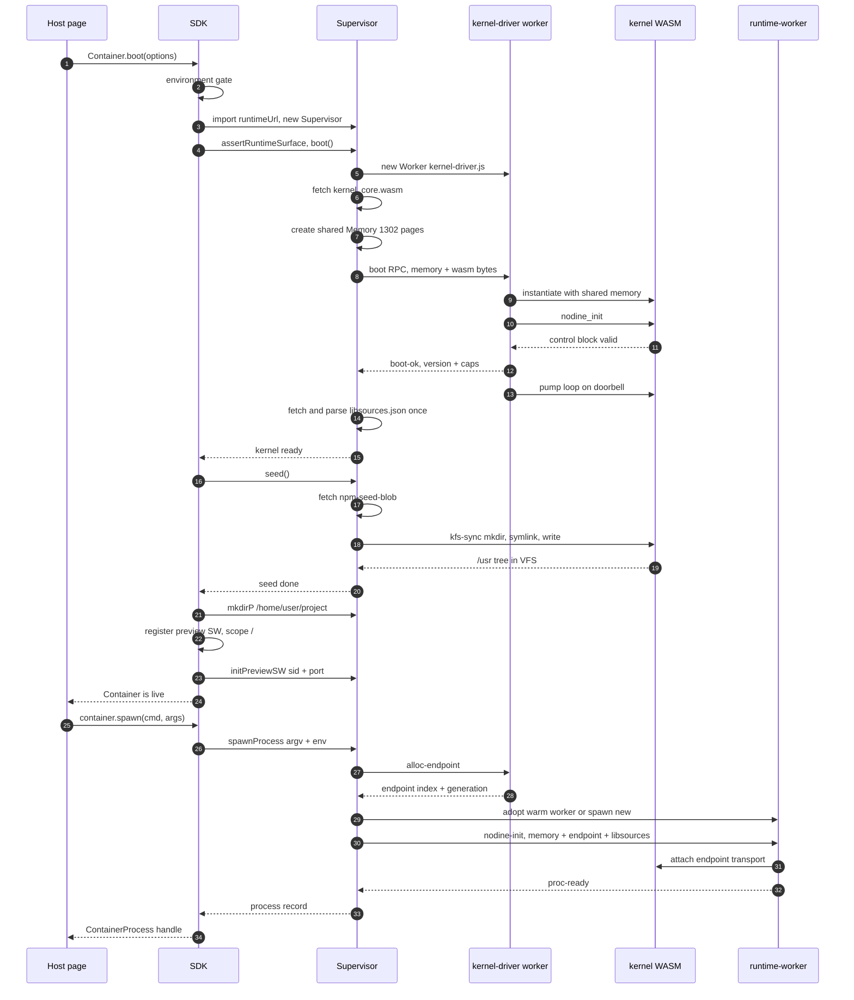
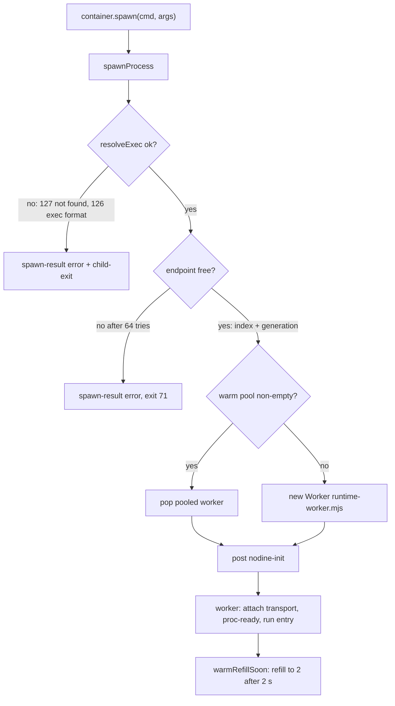

# How a container boots: from `Container.boot()` to a live Node.js runtime

This document walks through one boot, in order, from the moment a host page
calls `Container.boot()` to the moment the first spawned process reports
itself ready. Read `ARCHITECTURE.md` first for the layer map; the frozen
worker wire contract lives in `runtime-worker-contract.md`, and the kernel's
memory layout and syscall ABI live in `kernel/KERNEL_ABI.md`.

Files involved in the boot:

| File | Role |
| --- | --- |
| `src/environment.ts` | Browser capability gate run before anything loads |
| `src/runtime-adapter.ts` | `loadRuntimeModule` / `assertRuntimeSurface` / the headless terminal sink |
| `src/container.ts` | `Container.boot()`, the boot sequence, the preview bridge, `teardown()` |
| `src/vite.ts` | Serves the runtime bundle and the isolation headers in dev/build |
| `scripts/stage-runtime.mjs` | `npx nodine-stage` — copies the bundle for non-Vite hosts |
| `runtime/supervisor.mjs` | Page-side supervisor: kernel boot, VFS seeding, spawn, warm pool |
| `runtime/kernel-driver.js` | Kernel bootstrap worker: instantiates the WASM kernel, pumps it |
| `runtime/kernel_core.wasm` | The Rust microkernel binary |
| `runtime/libsources.json` | Vendored Node.js v26.13.0 library sources (431 modules) |
| `runtime/npm-seed-blob`, `runtime/npm-manifest.json` | The container's `/usr` image |
| `runtime/sw-nodine.js` | Preview service worker (scope `/`) |
| `runtime/runtime-worker.mjs` | One module worker per process |

## The whole boot at a glance

## 1. The environment gate

`Container.boot()` runs `environmentFailures()` (`src/environment.ts`) before
touching the network. The gate mirrors the runtime's canonical execution
profile: a desktop Chromium-class browser on a secure origin, cross-origin
isolated, with no fallback mode. Six checks run in this order:

| Check id | Passes when | Why the runtime needs it |
| --- | --- | --- |
| `browser-context` | `window` and `document` exist | The supervisor runs on the page's main thread |
| `cross-origin-isolated` | `window.crossOriginIsolated === true` | Gates `SharedArrayBuffer` and WASM threads below |
| `shared-array-buffer` | `SharedArrayBuffer` is defined | All kernel transport is shared-memory mailboxes |
| `service-workers` | `serviceWorker` in `navigator` | The preview gateway is a service worker (secure context: https or localhost) |
| `wasm` | `WebAssembly` is defined | The kernel is a WASM module |
| `wasm-threads-atomics` | A probe module with `(memory 1 1 shared)` + `atomic.i32.load` compiles | The kernel's transports are atomic ring buffers over shared memory |

If any check fails, `boot()` throws `EnvironmentUnsupportedError` immediately:
the message is `This browser environment cannot run the Nodine runtime: …`
with each failure message joined by `; `, the error code is
`ERR_NODINE_UNSUPPORTED_ENVIRONMENT`, and the machine-readable list is on the
`failures: string[]` property. Nothing is loaded — no runtime fetch, no
workers.

Two related gates run at the same time:

- **Single-boot guard.** The runtime owns one shared kernel per page. If a
  live `Container` already exists, a second `boot()` throws `BootFailedError`
  telling the caller to `teardown()` first.
- **`coep: 'none'` is rejected.** Passing `BootOptions.coep: 'none'` throws
  `EnvironmentUnsupportedError`: there is no non-isolated fallback mode, so
  the option cannot be honored. `require-corp` and `credentialless` pass
  through.

The COOP/COEP headers are a hard browser requirement, not a Nodine
preference: `SharedArrayBuffer` and shared-memory WASM are only exposed to
cross-origin-isolated documents. The embedding origin must send
`Cross-Origin-Opener-Policy: same-origin` plus
`Cross-Origin-Embedder-Policy: require-corp` (or `credentialless`) on the
page response. The Vite plugin does this for you in dev; any other host must
add the two headers itself (the README has per-host snippets for nginx,
Vercel, Netlify, and Express).

## 2. Loading the runtime module

`BootOptions.runtimeUrl` is optional. When omitted, the SDK uses
`DEFAULT_RUNTIME_URL = '/nodine/supervisor.mjs'` (exported from the package
root), which is exactly where the official Vite plugin serves the bundle and
where `npx nodine-stage` stages it.

`loadRuntimeModule()` (`src/runtime-adapter.ts`) does a dynamic
`import(runtimeUrl)` (marked `@vite-ignore` so Vite leaves the URL alone) and
validates the shape: the module must export a `Supervisor` class, otherwise
boot fails with a message stating that the module at that URL "does not
export a Supervisor class; it is not a Nodine runtime bundle". A fetch or
parse failure produces a `Could not load the Nodine runtime module from …`
error. `Container.boot()` wraps both into `BootFailedError`.

Two things provide that URL in practice:

- **The Vite plugin (`nodine/vite`).** `nodine()` adds a middleware to the
  dev/preview server that (1) sets `Cross-Origin-Opener-Policy: same-origin`
  and `Cross-Origin-Embedder-Policy: credentialless` (default; or
  `require-corp`) on every response, and (2) serves the bundle straight from
  `node_modules/nodine/runtime` under `/nodine/…` (configurable via the
  `path` option; `path: '/'` serves it at the origin root) with correct MIME
  types, `Service-Worker-Allowed: /` on bundle responses, and
  `Cache-Control: no-store`. `vite build` copies the bundle into the build
  output so the production tree is complete — the static host then only adds
  the two isolation headers.
- **`npx nodine-stage <dir>`.** Copies the runtime bundle into a directory
  your server already serves (`npx nodine-stage public/nodine`, or
  `--root` to serve it at the origin root) and prints the matching
  `runtimeUrl` to boot with.

The runtime resolves every asset relative to `supervisor.mjs`'s own URL
(`import.meta.url`): `kernel-driver.js`, `kernel_core.wasm`,
`libsources.json`, `npm-seed-blob`, `npm-manifest.json`, `runtime-worker.mjs`.
So the bundle works from any directory the host serves. The SDK also computes
`runtimeBase = new URL(runtimeUrl, document.baseURI)` for the one asset that
is not resolved by the supervisor itself: the preview service worker
(`sw-nodine.js`, loaded next to `supervisor.mjs` — see section 5).

After the import, the SDK constructs the supervisor headlessly:
`new Supervisor(term, statusEls, perf?)` where `term` is a
`HeadlessTermSink` (a write/meta buffer that fans raw ANSI output out to
`onOutput` subscribers) and `statusEls` are inert `{ textContent: '' }`
stubs for the five status slots the supervisor writes. If the host passed
`BootOptions.env`, those variables are layered into the supervisor's
`baseEnv` now — before any process exists — so knobs like
`NODINE_NETWORK_MODE` reach every spawned process.

`assertRuntimeSurface()` then verifies the 24 members the SDK actually calls:
`boot`, `seed`, `spawnProcess`, `signalTree`, `shutdown`, `initPreviewSW`,
the eleven filesystem helpers (`kstat`, `klstat`, `mkdirP`, `kmkdirOne`,
`kunlink`, `krmdir`, `ksymlink`, `kwriteFile`, `kreadWhole`, `kreaddir`,
`resolveSymlinks`), `abs`, `normalizePath`, `parentOf`, `baseEnv`, `stopped`,
`setKernel`, `status`. A mismatch throws
with the precise missing-member list, so an SDK/runtime version skew fails
loudly at boot instead of as a `TypeError` mid-session. `Container.boot()`
wraps that and any `supervisor.boot()` failure into
`BootFailedError: The Nodine kernel failed to boot: …`.

## 3. `supervisor.boot()`: kernel, shared memory, libsources

`Supervisor.boot()` (`runtime/supervisor.mjs`) brings up the one shared
kernel for the page:

1. **Kernel driver worker.** `new Worker(new URL('kernel-driver.js',
   import.meta.url))` — a classic worker, resolved next to
   `supervisor.mjs`. All further kernel control flows through its tagged
   RPC channel (`rpc()`: postMessage with a tag, reply matched by tag,
   30 s default timeout).
2. **Fetch the kernel binary.** `kernel_core.wasm` (~90 KB) is fetched
   relative to the supervisor's URL and read as an `ArrayBuffer`.
3. **Allocate the kernel shared memory (KSM).** `new WebAssembly.Memory({
   initial: 1302, maximum: 32768, shared: true })` — 1302 pages × 64 KiB
   ≈ 85 MB initial, hard maximum 32,768 pages = 2 GiB. This one memory
   object is the kernel's linear memory, its transport arena, and its VFS
   content store; every agent in the system (driver, process workers)
   attaches to the same backing store.
4. **The boot RPC.** One `boot` message carrying the KSM and the wasm bytes,
   with a 60 s timeout. In the driver: instantiate the module with the KSM
   as its imported `env.memory`, call the kernel entry point
   (`nodine_init`), then validate the control block at memory offset 0 —
   two magic words (`CARA`, `PCE1`) and state word 1. On success the driver
   replies `boot-ok { version, state, caps, maxEp, stride, stackPointer }`
   and enters its pump loop: the driver never busy-loops — it parks in
   `Atomics.waitAsync` on the doorbell word (offset 0x2000) and pumps the
   kernel in slices bounded to 512 ops per pass. On failure the driver
   replies `boot-failed` and boot throws.
5. **Status.** The supervisor records the `boot-ok` reply and reports
   `kernel v<major>.<minor> ready` through the (headless) status sink.
6. **The one-shot libsources fetch.** `libsources.json` (~6.5 MB — the
   vendored Node.js v26.13.0 library sources, 431 modules) is fetched once
   relative to the supervisor's URL and parsed once per page into a cached
   promise (`_libSourcesPromise`). Every spawned worker — pooled or fresh —
   receives the already-parsed object with its init message and never
   fetches the 6 MB file itself (structured-cloning a parsed object is
   several times cheaper than refetch + `JSON.parse`). If the fetch fails,
   the promise is cleared and workers fall back to fetching it themselves;
   boot does not fail.
7. **Warm pool kickoff.** When the libsources parse settles, the supervisor
   fills its warm worker pool (section 6) so the first interactive spawn can
   adopt a pre-booted worker.

If `boot()` throws, the SDK surfaces it as `BootFailedError`. No `Container`
exists at that point, so the caller has nothing to `teardown()`; the driver
worker the supervisor already opened stays parked until the page goes away.

## 4. `supervisor.seed()`: the `/usr` image

Unless the host passed `seedLibSources: false`, the SDK calls `seed()` next.
Seeding writes the container's entire userland into the kernel VFS through
endpoint 0's synchronous mailbox (`kfs-sync` RPCs: `mkdir`, `symlink`,
`open`+chunked `write`+`close`; each write chunk is ≤ 8128 bytes, the ABI's
sync-payload cap).

**Preferred path: the one-shot blob.** `seed()` first fetches
`npm-seed-blob` (~18.8 MB, one request) next to the supervisor module. The
blob is a CSB1 container: 4 magic bytes `CSB1`, a little-endian u32 JSON
length, a compact manifest, then a flat concatenation of every file's bytes.
Each `type: 'file'` manifest entry carries `off`/`len` into that data region.
The supervisor slices each file out with `ArrayBuffer.prototype.slice` — a
deliberate choice: `postMessage` clones a typed-array *view* by copying its
entire underlying buffer, so slicing views over the one big blob would copy
it thousands of times; `slice()` copies just that file's bytes.

**Fallback path: per-file.** If the blob is missing or malformed, `seed()`
fetches `npm-manifest.json` (3,330 entries: 2,748 files, 577 directories,
5 symlinks) and fetches every file individually via
`<runtime-base>/npm-file?p=<path>` requests through an 8-wide prefetch
pipeline. This path requires the host to implement the `npm-file` route next
to the bundle; the Vite plugin does not (it serves real files only), but with
the plugin the blob fetch succeeds and the fallback never triggers.

**What lands in the VFS:**

- npm 12.2.2 at `/usr/lib/node_modules/npm` (with `/usr/bin/npm` and
  `/usr/bin/npx` symlinking into its `bin/` scripts)
- `/usr/lib/node_modules/shell` (the shell package `/bin/sh` runs),
  `pako`, `@noble/hashes`, plus a `noble-hashes` alias symlink
- `/usr/bin/node` — a stub whose shebang makes `node` resolve to the runtime
- `/bin/sh` — a stub file that boots the vendored shell
- coreutils in `/usr/bin` as real programs (mode 0o755): `ls`, `cat`, `echo`,
  `head`, `tail`, `grep`, `wc`, `touch`, `mkdir`, `rmdir`, `rm`, `cp`, `mv`,
  `find`, `which`, `env`, `chmod`, `true`, `false` — each a copy of the same
  multi-call source, dispatched on `argv[1]`
- `/home/user/demo/` — two small demo files (`readme.md`, `notes.txt`)

After the manifest entries, `seed()` writes the demo workspace at
`/project/`: `package.json` (`nodine-demo`), `main.js` (a hello-world that
optionally requires `left-pad`), and `preview-demo.js` (an HTTP server that
listens on port 3999 for preview smoke tests).

Seeding failure is not fatal: the SDK catches it, reports
`[nodine] libsource seeding failed: …` through the terminal sink, and
continues — the result is a booted container with a bare kernel and an empty
`/usr` tree (spawn of anything beyond `node` will then fail PATH search).

## 5. Workdir creation and the preview bridge

Back in `Container.boot()` (this order matters — the kernel and VFS exist
before anything below runs):

1. **Working directory.** `workdirName` defaults to `'project'`, giving
   `/home/user/project` (`Container.workdir` reports it). The SDK
   `mkdirP`s it; a failure is swallowed and boot continues with the
   requested path.
2. **Preview bridge** (`initPreviewBridge`, skipped when
   `enablePreview: false`). This is best-effort by design — any failure
   leaves the container fully working, just without preview events:
   - Register `sw-nodine.js` (resolved against `runtimeBase`, i.e.
     next to `supervisor.mjs`) with **scope `/`** so it can intercept
     origin-rooted `/preview/…` URLs. Scope `/` from a non-root script URL
     requires the server to send `Service-Worker-Allowed: /` for
     `sw-nodine.js` — the Vite plugin does; other hosts must (or
     serve the bundle at the origin root, where no header is needed).
   - Wait for `navigator.serviceWorker.ready`, then locate the active
     worker instance (controller, or the registering one, polling up to
     50 × 100 ms).
   - Mint a session id: `sid = crypto.randomUUID()`. Open a
     `MessageChannel`; hand **port1** to the supervisor via
     `supervisor.initPreviewSW(sid, port1)` and **port2** to the service
     worker via `{ type: 'preview-bridge', sid, forwardErrors }`.
     `forwardErrors` encodes `BootOptions.forwardPreviewErrors`:
     `'all'` (true: exceptions + `console.error`), `'exceptions'`
     (`'exceptions-only'`), or `null` (no error-hook injection — the
     default).
   - Wire the supervisor's page hooks: `onPreviewEvent` maps worker
     `port-open`/`port-close` announcements onto the SDK's
     `server-ready` and `port` events, with the preview URL shape
     `/preview/<sid>/<port>/`; `onPreviewMessage` maps SW error events
     onto `preview-message` events
     (`PREVIEW_UNCAUGHT_EXCEPTION`, `PREVIEW_UNHANDLED_REJECTION`,
     `PREVIEW_CONSOLE_ERROR`), dropping anything with a stale sid.
   - Every process spawned from now on also gets its own MessageChannel to
     the SW (`preview-worker-chan`), passed inside its init message, so a
     `listen()` inside any worker is reachable through the gateway.

After this, `Container.bootedInstance` is set and the `Container` is
returned. The container is live.

## 6. The first spawn and the warm worker pool

### 6.1 SDK side (`container.spawn`)

The SDK assembles the call: `argv = [command, ...args]`; `env` is the
supervisor's `baseEnv` layered with `options.env`; `cwd` is
`options.cwd` (resolved against the workdir) or the workdir itself; stdio is
`['pipe','pipe','pipe']` (or all-`ignore` with `output: false`, or
`'inherit'` with `stdio: 'inherit'`). It then creates a `MessageChannel`
and a **synthetic parent** record (pid `-1`) holding `port2`, and calls
`supervisor.spawnProcess({ argv, env, cwd, stdioMode, parent, viaPort })`.
The synthetic parent is what makes piped IO work: the supervisor posts
spawn results, stdout/stderr bytes, and exit codes to the parent's port, and
the SDK — listening on `port1` — turns them into the
`ContainerProcess` handle (`input` WritableStream → `stdin-bytes`/
`stdin-eof`, `output` ReadableStream ← `child-stdout`/`child-stderr`,
`exit` promise ← `child-exit`).

### 6.2 Supervisor side (`spawnProcess`)

1. **Settle libsources.** The page-wide cached parse is awaited exactly
   once; the parsed object is remembered for every later spawn.
2. **Exec resolution** (`resolveExec`): `argv[0]` with `/` is used as a
   path, otherwise PATH search via kernel `stat`; the symlink chain is
   resolved (≤ 8 hops). `/usr/bin/node` is the self-stub: `node -v` prints
   the real v26.13.0 core version, `node -e/-p` evals, `node script.js`
   sets the entry. Otherwise the first 128 bytes are read: a node-family
   shebang (or a `.js`/`.mjs`/`.cjs` extension) makes it a node script;
   any other interpreter or binary is `exec format error`. Failures return
   `null` with exit 127 (not found) or 126 (exec format), posted to the
   caller's `viaPort` as `spawn-result` + `child-exit`; the SDK throws
   `SpawnError`.
3. **Endpoint allocation.** An `alloc-endpoint { pid, caps: 3 }` RPC to the
   driver (capability mask 3 = sync + async transports) carves a kernel
   endpoint out of the fixed table (64 slots) for this process; the reply
   carries `{ index, generation }`. If the pid collides, the supervisor
   retries with the next pid, up to 64 attempts; exhaustion reports
   `no free kernel endpoint` with exit 71.
4. **Worker acquisition.** Pop a worker from the warm pool if one is
   available, otherwise `new Worker(WORKER_URL, { type: 'module' })`.
   `WORKER_URL` is `runtime-worker.mjs` resolved against the supervisor's
   own URL, carrying the supervisor module's `?v=` content-stamp if
   present, so a re-staged bundle can never boot a stale worker from cache.
5. **`nodine-init`.** The frozen init message posted to the worker:

   | Field | Content |
   | --- | --- |
   | `ksmMemory` | The shared kernel memory (same object as the driver's) |
   | `epIndex`, `generation` | This process's kernel endpoint |
   | `pid`, `entry`, `argv`, `argv0`, `code` | Process identity and entry; `code` is a pre-evaled string for `-e`/`-v` forms |
   | `env`, `cwd` | The process environment and working directory |
   | `stdioMode`, `stdioArr` | Per-spawn stdio policy (string or per-fd array) |
   | `channelPort` | The `port2` end of the SDK's channel (transferred) |
   | `previewSWPort` | This worker's channel to the preview SW, when the bridge is up |
   | `files` | Always `null` — the VFS is pre-seeded through endpoint 0 |
   | `libSources` | The page's parsed libsources object — no per-worker fetch |
   | `perf` | Whether worker instrumentation is on |

6. **Bookkeeping.** Parentless spawns (or the synthetic pid `-1` parent)
   become the foreground process; the terminal-owner (the deepest live
   process actually reading fd 0) is re-derived; `spawn-result { pid }` goes
   to the caller's `viaPort`; the process table updates; and
   `warmRefillSoon()` schedules a pool refill.

### 6.3 Worker side

`runtime-worker.mjs` installs its `onmessage` at module top — before its
first `await` — so an init message posted during the libsources/uvmap window
is never lost. The module top parses libsources (handed in, or fetched as a
fallback), fetches `uvmap.json` (libuv's errno map), captures platform
globals, then parks at `await initPromise` until a `nodine-init` arrives.
On init it attaches its transport to its endpoint in the KSM, reports
`proc-ready`, and runs the entry through the genuine Node bootstrap chain
from the libsources. The supervisor marks the record ready on `proc-ready`
and the SDK's `spawn()` promise resolves with the handle.

### 6.4 The warm pool

The pool exists because almost all of a worker's module top is
process-independent: the module fetch/parse, libsources parse, uvmap fetch,
and platform captures. A **warm worker** is one that has done all of that and
is parked at `await initPromise`, message handler installed, waiting. The
supervisor's `warmCreate()` starts such a worker and, as soon as the
page-wide libsources parse settles, posts it a `warm-preinit` message with
the parsed payload (the message queues until the worker installs its
handler; the parked worker keeps the copy but stays parked — only a real
`nodine-init` resolves `initPromise`). A warm worker's `onmessage` is left
unset until adoption, so its queued startup reports simply flow to the
adopting process's handler.

- **Pool target:** 2 idle workers (`warmTarget = 2`).
- **Refill:** `warmRefillSoon()` is deferred by 2 s and single-flighted, so a
  burst of spawns never pays pool refill on the interactive path. It runs
  once after the boot-time libsources parse and after every spawn.
- **Adoption:** `warmWorkers.pop()`; the pooled spawn then costs only the
  `nodine-init` post and the worker's resume path (transport attach →
  `proc-ready` → entry). The fresh-worker path remains as the fallback when
  the pool is drained.
- **Drain:** `warmDrain()` terminates every pooled worker at shutdown.

The spawn decision:

## 7. `teardown()`: what gets released

`Container.teardown()` is idempotent and runs the shutdown in order:

1. **Kill tracked processes.** Each live `ContainerProcess` gets
   `kill()`: a `SIGTERM` to the process tree, with a `SIGKILL` fallback
   scheduled 3 s later if the tree ignores it.
2. **Runtime shutdown** (`supervisor.shutdown(0)`):
   - the warm pool is drained — every pooled idle worker is terminated;
   - every process record gets an `endpoint-died { index, generation }` RPC
     (the kernel frees the endpoint slot) and its worker is terminated;
   - the process table, foreground pointer, and terminal-owner pointer are
     cleared;
   - a final `shutdown` RPC makes the driver call the kernel's shutdown
     entry point and then perform a last notify sweep over every endpoint's
     sequence counters (≤ 64 × 2 `Atomics.notify` calls) so no waiter
     anywhere hangs; the driver reports `kernel-stopped`.
3. **Preview session teardown.** The SDK nulls its supervisor-side hooks and
   posts `{ type: 'preview-bridge-end', sid }` to the service worker, which
   drops the session's port registry and the bridge port — still-open
   preview tabs stop forwarding, and nothing leaks into the next boot. The
   service worker registration itself stays (sessions are per-boot, the
   registration is per-origin).
4. **Instance slot.** `Container.bootedInstance` is cleared, so the next
   `Container.boot()` can succeed. The instance is marked destroyed: any
   further API call throws `ContainerDestroyedError`.

Process exit promises resolve during shutdown (via `child-exit` or the
record's exited flag), and the SDK closes each process's MessagePorts after
a short macrotask so trailing output chunks are not dropped. One thing has
no explicit release: the shared `WebAssembly.Memory`. There is no free
operation — the KSM becomes collectable once the driver and all workers
holding it are terminated and the supervisor's references are gone.
