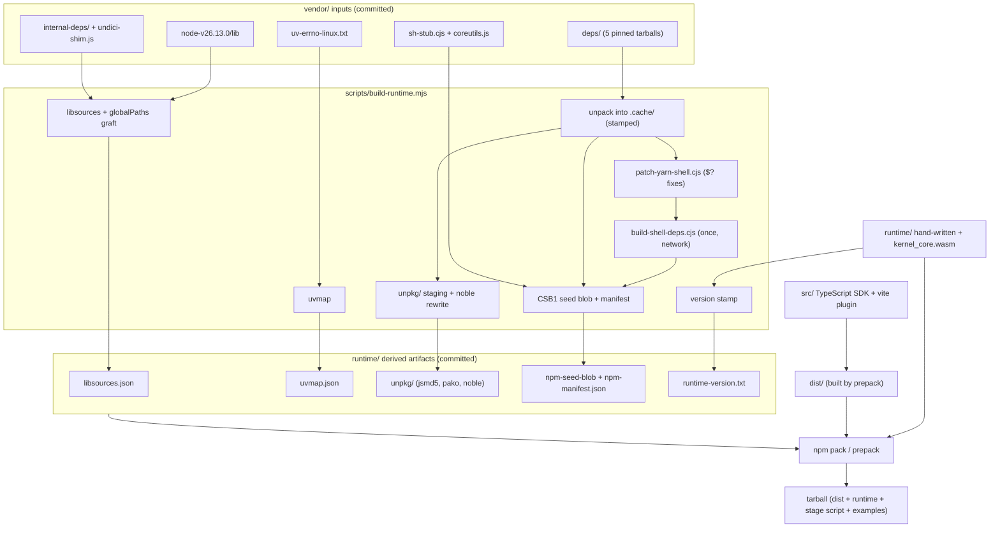
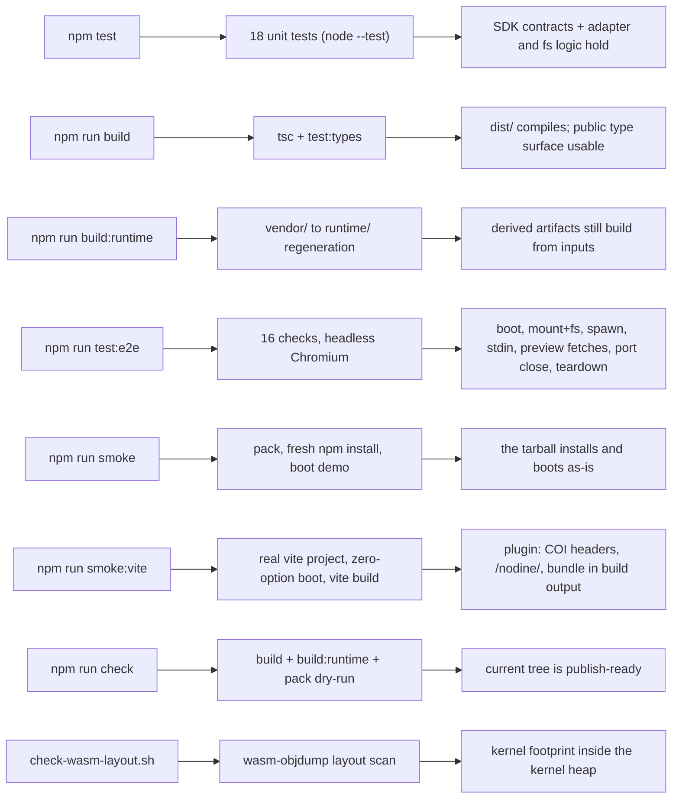

# Building and contributing

This page is for people working **in** this repository — contributors and
maintainers. If you only *use* `nodine` in an app, the [README](../README.md) is
the entry point; here we cover how the package is built, verified and published.
Everything below describes the current tree; every script, path and flag named
here exists in the repository as written.

Prerequisites for working in the repo: Node.js ≥ 18 (the `engines` floor —
`node --test`, used by `npm test`, needs it), npm, and — for the kernel — a
nightly Rust toolchain with the `wasm32-unknown-unknown` target. The
browser-level gates additionally need Playwright with its Chromium build
installed (see [Verification gates](#verification-gates)).

## Repository map

`src/` holds the TypeScript sources of the public SDK — `container.ts`,
`fs-adapter.ts`, `runtime-adapter.ts`, `environment.ts`, `errors/`, `types/`,
`version.ts`, `index.ts` — plus the Vite plugin in `vite.ts`; it compiles to
`dist/` (gitignored, built at pack time). `runtime/` is the static runtime
bundle the SDK boots: seven hand-written files — `supervisor.mjs` (page-side
process supervisor), `runtime-worker.mjs` (Node execution worker, one per
process), `kernel-driver.js` (kernel bootstrapping worker), `kernel_core.wasm`
(the compiled Rust/WASM kernel binary), `sync-module-wrap.mjs`,
`acorn-vendor.mjs`, `sw-opencontainer.js` (the preview service worker) — plus
six derived artifacts regenerated from `vendor/` by
`scripts/build-runtime.mjs`: `libsources.json`, `uvmap.json`, `unpkg/`,
`npm-manifest.json`, `npm-seed-blob`, `runtime-version.txt`. `kernel/` is the
Rust Cargo workspace that builds the kernel, together with the frozen ABI
specification `kernel/KERNEL_ABI.md`. `vendor/` holds the upstream inputs
(upstream Node.js v26.13.0 lib sources, pinned dependency tarballs,
`internal/deps` dists, the undici shim, the libuv errno table, the `/bin/sh`
stub source and the coreutils source — see `vendor/README.md` for the full
provenance table). `scripts/` contains the build, patch, staging and smoke
scripts described below. `test/` holds the `node --test` unit tests, the
type-surface file `test/surface.test-d.ts`, and the browser E2E
(`e2e.cjs` + `e2e.html`). `examples/demo/` is a runnable end-to-end demo (one
HTML page plus a small cross-origin-isolation dev server, `server.mjs`).
`docs/` holds this page, the [architecture overview](ARCHITECTURE.md) and the
[supervisor–worker wire contract](runtime-worker-contract.md).

## The build pipeline

There are two independent builds: the SDK (`npm run build`, TypeScript to
`dist/`) and the runtime bundle's derived artifacts (`npm run build:runtime`,
`vendor/` inputs to `runtime/`). `npm run check` runs both plus a pack dry-run.

### `npm run build` — the SDK

```
npm run clean && tsc -p tsconfig.build.json && npm run test:types
```

- `clean` deletes `dist/` (`node -e "require('fs').rmSync('dist', ...)"`).
- `tsc -p tsconfig.build.json` compiles `src/` → `dist/`: strict mode, target
  ES2022, `module`/`moduleResolution` NodeNext, emitted `.d.ts` declarations
  and declaration maps, `stripInternal`, `noUnusedLocals` /
  `noUnusedParameters`. The published entry points are `dist/index.js` and
  `dist/vite.js` (the `exports` map in `package.json`).
- `test:types` type-checks `src/`, `test/` and `scripts/` with
  `tsc -p tsconfig.test.json --noEmit`, or — if that invocation fails — retries
  through `node scripts/check-types-fallback.cjs`. This compiles
  `test/surface.test-d.ts`, which assigns mock implementations against every
  declared public interface to verify the API surface is structurally
  complete; it has no runtime behavior.

### `npm run build:runtime` — the derived bundle artifacts

`node scripts/build-runtime.mjs` regenerates every derived artifact in
`runtime/` from committed inputs in `vendor/`. It is deterministic; re-runs are
incremental via stamp files. The steps, in order:

1. **Unpack the vendored tarballs into `.cache/`** (gitignored). The five
   `vendor/deps/` tarballs unpack into short-named trees:
   `npm-12.2.2.tgz` → `.cache/npm/`, `yarnpkg-shell-4.1.3.tgz` →
   `.cache/shell/`, `pako-2.1.0.tgz` → `.cache/pako/`,
   `noble-hashes-1.8.0.tgz` → `.cache/noble/`, `js-md5-0.8.3.tgz` →
   `.cache/jsmd5/`. Each tree has a stamp file (`.cache/<name>.stamp`) that
   records the source tarball, so an already-unpacked tree is skipped on the
   next run.
2. **Re-apply the `$?` patches to `@yarnpkg/shell`.** A fresh unpack resets the
   tarball, so every build runs `scripts/patch-yarn-shell.cjs`. The two fixes
   are marker-guarded and idempotent (each checks for a `// nodine-patch:`
   marker before editing):
   - `lib/index.js`: `variables[?]` is initialized as the *string* `` `0` ``
     instead of the number `0` — the number reached `String.split()` /
     `raw.match` and crashed the first `$?` reference.
   - `lib/globUtils.js`: `$NAME` / `${NAME}` references are stripped before
     the micromatch glob scan — a `?` inside a `$`-reference (`a=$?`) was
     misclassified as a glob character, so `echo "code=$?"` failed with
     `No matches found`.
3. **Optional one-time install of the shell dependency closure.** The
   `@yarnpkg/shell` tarball ships without its production dependencies, so
   `/bin/sh` would die with `Cannot find module 'tslib'`. If
   `.cache/shell/package/node_modules/tslib` is missing — a fresh clone or a
   wiped `.cache/`, i.e. exactly when a fresh unpack happened — the build runs
   `scripts/build-shell-deps.cjs`: it installs the pinned closure
   (`@yarnpkg/fslib@3.1.5`, `@yarnpkg/parsers@3.1.0`, `chalk@4.1.2`,
   `clipanion@4.0.0-rc.4`, `cross-spawn@7.0.6`, `fast-glob@3.3.3`,
   `micromatch@4.0.8`, `tslib@2.9.1`) from the npm registry into a scratch
   prefix and moves the tree into
   `.cache/shell/package/node_modules` with `verbatimSymlinks` (so `.bin/`
   symlinks survive as symlinks). **This is the only network step in the whole
   pipeline**, and it never blocks publishing: its output ends up committed
   inside `runtime/npm-seed-blob`. The build then hard-verifies that `tslib`
   exists and fails loudly on a bad unpack.
4. **`libsources.json`.** The verbatim `vendor/node-v26.13.0/lib` tree is read
   with *extensionless* ids (`_http_agent`, not `_http_agent.js`) because the
   runtime worker's builtin loader requests them that way. Into the same file:
   the browser-fetch shim `vendor/undici-shim.js` is injected as
   `internal/deps/undici/undici` (it backs global `fetch`), and
   `vendor/internal-deps/` (acorn, acorn-walk, minimatch) is injected under the
   exact `internal/deps/` ids Node uses for them. Finally the **globalPaths
   graft**: `internal/modules/cjs/loader` gets a few lines injected after
   `Module._initPaths()` that push `/usr/lib/node_modules` onto
   `Module.globalPaths` (the `B26` marker is visible in the generated comment)
   — the emulated node installs global packages there, and every
   global-package resolver in the ecosystem reads
   `node:module.globalPaths` expecting the npm root among the entries. The
   file records `nodeVersion`, the lib tarball `tarballSha256`, the id count,
   the id list and the sources.
5. **`uvmap.json`.** Parsed from `vendor/uv-errno-linux.txt` into
   `{name, value, message}` records — the libuv errno map the runtime worker
   uses.
6. **`unpkg/` staging.** `runtime/unpkg/` is rebuilt from scratch: the
   `.cache/{jsmd5,pako,noble}/package` trees are copied to
   `runtime/unpkg/{jsmd5,pako,noble}` (the worker imports these ESM trees
   directly by URL). In the noble tree, every bare `@noble/hashes/...`
   specifier is rewritten to a relative `./....js` URL so the browser resolves
   the imports without a bundler.
7. **Seed blob + manifest.** The container's `/usr` image is assembled: the
   npm, shell, pako and `@noble/hashes` trees under
   `/usr/lib/node_modules/…` (plus a `noble-hashes` symlink), `/usr/bin/npm`
   and `/usr/bin/npx` symlinks into the npm CLI, a `node` exec stub, `/bin/sh`
   from `vendor/sh-stub.cjs`, nineteen coreutils programs (`ls`, `cat`,
   `echo`, `head`, `tail`, `grep`, `wc`, `touch`, `mkdir`, `rmdir`, `rm`,
   `cp`, `mv`, `find`, `which`, `env`, `chmod`, `true`, `false`) split from
   the multi-call source `vendor/coreutils/coreutils.js` as real `/usr/bin`
   executables, and a small demo workspace under `/home/user`. Output:
   `runtime/npm-manifest.json` (the per-file fallback manifest + index) and
   `runtime/npm-seed-blob`, the CSB1 one-shot blob the supervisor prefers —
   an 8-byte `CSB1` header (magic + JSON length), the JSON index, then the
   concatenated file bytes: one fetch instead of thousands of per-file
   requests.
8. **Version stamp.** `runtime/runtime-version.txt` gets the content hash:
   12 hex chars of SHA-256 from each of `supervisor.mjs`,
   `runtime-worker.mjs` and `kernel-driver.js`, concatenated (36 chars).
   Hosts append it as a `?v=` parameter to the supervisor URL to cache-bust
   (see [Contributor recipes](#contributor-recipes)).

### Committed vs derived in `runtime/`

| File | Kind |
| --- | --- |
| `supervisor.mjs`, `runtime-worker.mjs`, `kernel-driver.js`, `kernel_core.wasm`, `sync-module-wrap.mjs`, `acorn-vendor.mjs`, `sw-opencontainer.js` | hand-written, shipped verbatim |
| `libsources.json`, `uvmap.json`, `unpkg/`, `npm-manifest.json`, `npm-seed-blob`, `runtime-version.txt` | derived, regenerated by `npm run build:runtime` |

**Both groups are committed.** That is deliberate: `dist/` and `.cache/` are
gitignored (`.gitignore` lists `dist/`, `node_modules/`, `.cache/`, `*.log`,
`.npm/`, `*.tgz`), but `prepack` builds `dist/` at pack time, so a fresh
clone is always publish-ready: `npm pack` (and therefore `npm publish`)
builds `dist/` on the spot, with no prior build step, no dependency
downloads and no network. `npm run build:runtime` is only needed when a
`vendor/` input or a runtime JS file changes.



## The kernel build

`kernel/` is a Cargo workspace (`resolver = "2"`) with three members:
`crates/kernel-abi` (the normative constants/layout definitions),
`crates/kernel-core` (the kernel itself) and `crates/kernel-vfs-bench` (a
benchmark harness). `crates/kernel-vfs` is a **path dependency of
`kernel-core` but excluded from the workspace members**: its standalone host
test runs need unwinding panics with their own profile tables, while wasm
builds pull it in with the workspace's production profile
(`panic = "immediate-abort"`). Its host-side suite lives in
`kernel/crates/kernel-vfs/tests/` (`fd_ops.rs`, `vfs_ops.rs`,
`extraction_fuzz.rs`).

The kernel builds for `wasm32-unknown-unknown` and **requires a nightly Rust
toolchain** — `kernel/Cargo.toml` starts with
`cargo-features = ["panic-immediate-abort"]`, and both profiles set
`panic = "immediate-abort"`. All link configuration rides the target
rustflags in `kernel/.cargo/config.toml`:

| rustflag | Purpose |
| --- | --- |
| `-C link-arg=--import-memory` / `--shared-memory` | the kernel's linear memory is an **imported, shared** `WebAssembly.Memory` (SharedArrayBuffer + wasm threads are hard requirements) |
| `-C link-arg=--max-memory=2147483648` | 2 GiB memory ceiling |
| `-C link-arg=--export=__stack_pointer` / `--export=__heap_base` | exported so the layout gate can assert them |
| `-C link-arg=-zstack-size=84410368` | relocates the module's `[stack][data]` footprint into the kernel heap; the stack top is `0x0508_0000` |
| `-C target-feature=+atomics,+bulk-memory,+mutable-globals,+sign-ext` | the features the shared-memory profile needs |

Why the layout is load-bearing: the shared memory begins with the ABI map —
the kernel control block sits at **linear address 0** — as specified by the
frozen ABI in [`kernel/KERNEL_ABI.md`](../kernel/KERNEL_ABI.md) (v1.0.2, the
single byte-level shared-memory interface between the runtime workers and the
kernel: control structures, operation table, rings, and the two endpoint
classes). The module's own footprint must stay out of that map: the stack
lives at the top of the kernel heap (`__stack_pointer` init `0x0508_0000` =
`KERNEL_HEAP_BASE + 128 KiB`), there are **no active data segments** (an
active segment would write the ABI map at instantiation — passive segments
are only `memory.init`-ed to destinations at or above `KERNEL_HEAP_BASE`
`0x0506_0000`), and `__heap_base` — the linker-computed end of the
`[stack][data]` block — must stay below the kernel-heap header at
`0x0509_0040`. Kernel-internal state never uses Rust statics (they would
create data segments); it lives in the kernel heap at explicit offsets.

`scripts/check-wasm-layout.sh` is the gate that enforces all of this. It
takes an optional path argument (default:
`kernel/target/wasm32-unknown-unknown/release/kernel_core.wasm` — pass
`runtime/kernel_core.wasm` to check the shipped copy) and needs
`wasm-objdump` from the `wabt` package. Exit 0 = layout OK; exit 1 = layout
violation, and the build must fail. It checks, in order:

1. `__stack_pointer` is exported and initialized to `0x0508_0000`;
2. no active data segments are present;
3. every `memory.init` destination is ≥ `0x0506_0000`;
4. `__heap_base` is exported and ≤ `0x0509_0040`.

Rebuilding the kernel: run
`cargo build --release --target wasm32-unknown-unknown` from `kernel/`, copy
`kernel/target/wasm32-unknown-unknown/release/kernel_core.wasm` over the
committed `runtime/kernel_core.wasm`, then run
`scripts/check-wasm-layout.sh runtime/kernel_core.wasm`. The compiled kernel
ships in the tarball via `runtime/`; `kernel/` itself is never published.

## Verification gates

All gates run from the package root. `npm test` and `npm run build` need
neither a browser nor network access. The browser gates — `npm run
test:e2e`, `npm run smoke`, `npm run smoke:vite` — need Playwright with its
Chromium build, which is not a devDependency of this package: install it in
your checkout (e.g. `npm i -D playwright && npx playwright install
chromium`). `npm run smoke:vite` additionally installs vite from the
registry, so it needs network access.

- **`npm test`** — `node --test test/contracts.test.mjs test/adapter.test.mjs`,
  18 unit tests: 7 contract tests in `test/contracts.test.mjs` (the exported
  SDK surface, boot rejection outside a browser, option forwarding, error
  classes and their messages) and 11 adapter tests in `test/adapter.test.mjs`
  (the output sink, the supervisor-surface assertion, and the fs lane:
  `mkdir`/`writeFile`/`readFile` round-trips, `readdir` with and without
  `withFileTypes`, `rm`/`rename`/error paths, encodings). Proves the SDK's
  contracts and adapter logic without a browser.
- **`npm run build`** — includes `npm run test:types` (see above), so every
  build also proves the public type surface still compiles for consumers.
- **`npm run test:e2e`** — `node test/e2e.cjs [port]` (default port 8899).
  Boots `examples/demo/server.mjs` — one origin with the COOP/COEP isolation
  headers, the built SDK at `/sdk/` (so `npm run build` must run first) and
  the runtime bundle at the origin root — then drives `test/e2e.html` in
  headless Chromium via Playwright. The page runs **16 checks**: `boot`,
  `workdir`, `path`, `mount+readFile`, `fs.readdir`,
  `fs.writeFile round-trip`, `fs.readdir withFileTypes`, `spawn output`,
  `spawn exit code`, `stdin->stdout echo`, `server-ready event`,
  `preview url serves (first fetch)`, `preview url serves (second fetch)`,
  `preview port closed after kill`, `teardown`, `post-teardown throws`.
  Proves the real runtime boots and the full SDK flow — mount, fs, spawn,
  stdin, preview URLs (twice), port cleanup, teardown — works end-to-end in
  the browser the runtime actually targets.
- **`npm run smoke`** — `node scripts/smoke-install.cjs`, the
  "npm install and it just works" gate. It runs `npm pack`, installs the
  tarball into a fresh consumer project in a scratch directory, asserts the
  installed tree really contains `dist/index.js`,
  `runtime/supervisor.mjs`, `runtime/kernel_core.wasm`,
  `runtime/libsources.json`, `runtime/npm-seed-blob`,
  `scripts/stage-runtime.mjs` and `examples/demo/server.mjs`, then starts
  the demo server **from the installed package** (port 8910) and drives the
  demo page headlessly. Pass requires zero failed log lines, a `booted` line
  and a `preview URL` line, plus no page errors. Proves the published
  artifact, not the repo tree, is installable and bootable.
- **`npm run smoke:vite`** — `node scripts/smoke-vite.cjs`, the
  "install → one plugin line → boot" gate. It packs, scaffolds a **real vite
  project** in a scratch directory (vite from the registry, nodine from the
  tarball, `vite.config.mjs` containing `plugins: [nodine()]`), starts
  `vite dev` on port 8920 and boots with `Container.boot()` and **zero
  options** — no `runtimeUrl`, no header config. The in-page checks cover:
  cross-origin isolation, zero-option boot, service-worker registration and
  controller, spawn output and exit code, the `server-ready` preview event,
  a fetch through the preview URL, and teardown. It then runs `vite build`
  and verifies the build output contains the runtime bundle:
  `dist/nodine/supervisor.mjs`, `kernel_core.wasm`, `npm-seed-blob`,
  `sw-opencontainer.js`, `libsources.json`. Proves the official plugin path
  — COI headers, the bundle served from `node_modules` at `/nodine/`, and
  the production copy — works with no manual setup.
- **`npm run check`** — `npm run build && npm run build:runtime && npm pack
  --dry-run`: rebuilds both halves from their inputs and proves the current
  tree packs cleanly. (`npm pack` runs `prepack`, which is `npm run build`.)
- **`scripts/check-wasm-layout.sh`** — the kernel memory-layout gate (see
  [The kernel build](#the-kernel-build)). Proves the wasm module's footprint
  stays inside the kernel heap and off the ABI map.



## Publishing

`prepack` runs `npm run build`, so `npm publish` and `npm pack` always ship a
freshly compiled `dist/`. The `files` whitelist in `package.json` is:

```
dist
runtime
scripts/stage-runtime.mjs
examples
README.md
LICENSE
NOTICE
```

— plus `package.json` itself (npm always includes it) and the
`bin.nodine-stage` entry pointing at `scripts/stage-runtime.mjs`.
**Not** in the tarball: `vendor/`, `kernel/`, `test/`, `src/`, `docs/`, the
tsconfigs, `.cache/`. Consumers get the compiled SDK (`dist/`) and the
executable bundle (`runtime/`), not the build inputs.

Measured with `npm pack --dry-run` on the current tree: **package size
6.7 MB** (about 30.2 MB unpacked) and **345 files** — 299 under `runtime/`,
39 under `dist/`, 2 under `examples/`, plus the stage script and the four
metadata files. The heavyweights are `runtime/npm-seed-blob` (~18 MB
unpacked) and `runtime/libsources.json` (~6 MB); gzip compresses the whole
package to ~6.7 MB.

Publishing never needs network access: the derived runtime artifacts are
committed, so a fresh clone packs completely offline. The one network step
anywhere in the pipeline — the pinned shell-closure install — runs only
when `.cache/` is being rebuilt, and its result already lives inside the
committed `runtime/npm-seed-blob`.

`npm run stage` (`npx nodine-stage [--root] <output-dir>`) is the consumer
side of the bundle: it copies `runtime/` into a directory your static server
serves. It is also handy during development for testing a changed bundle
against a static server of your own.

## Contributor recipes

**Touched anything under `vendor/`?** Run `npm run build:runtime`, then
review and commit the regenerated derived artifacts
(`libsources.json`, `uvmap.json`, `unpkg/`, `npm-manifest.json`,
`npm-seed-blob`, `runtime-version.txt`). The first run on a fresh clone —
or after wiping `.cache/`, which is gitignored — needs network access for
the one-time pinned shell-closure install (`scripts/build-shell-deps.cjs`
triggers exactly when `.cache/shell/package/node_modules/tslib` is missing).
Subsequent runs are offline and skip re-unpacking via the stamp files.

**Touched runtime JS (`supervisor.mjs`, `runtime-worker.mjs`,
`kernel-driver.js`)?** Run the same script: step 8 rewrites
`runtime/runtime-version.txt`, which hashes exactly those three files, so
any runtime change produces a new stamp. Commit it — hosts cache-bust with
it by fetching the stamp and appending it to the supervisor URL:

```ts
const v = await (await fetch('/nodine/runtime-version.txt', { cache: 'no-store' })).text();
const container = await Container.boot({ runtimeUrl: `/nodine/supervisor.mjs?v=${v.trim()}` });
```

That busts both the browser's module cache and the worker caches. The Vite
plugin takes the dev-server route instead: it serves runtime assets with
`Cache-Control: no-store` (see the middleware in `src/vite.ts`).

**Touched the kernel?** Rebuild it, copy the wasm over
`runtime/kernel_core.wasm`, run `scripts/check-wasm-layout.sh
runtime/kernel_core.wasm`, commit the binary (it is committed by design —
that is what makes a fresh clone publish-ready), then run the browser gates
(`npm run test:e2e` at minimum; the smokes when the driver or supervisor
surfaces changed).

**Where to add tests:**

- SDK contract or behavior → `test/contracts.test.mjs`
- adapter / fs-lane logic → `test/adapter.test.mjs`
- public type surface → `test/surface.test-d.ts` (compiled by
  `npm run test:types`)
- browser end-to-end → add a `check()` to `test/e2e.html`; the driver
  (`test/e2e.cjs`) reports every result automatically
- Vite-plugin path → the in-page checks in `scripts/smoke-vite.cjs`
- kernel VFS → the host-side suites in `kernel/crates/kernel-vfs/tests/`
