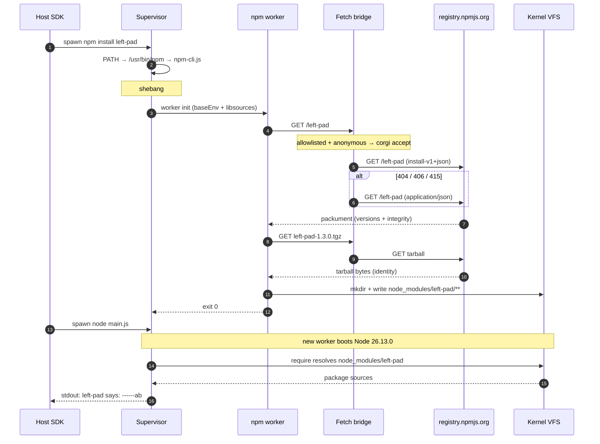
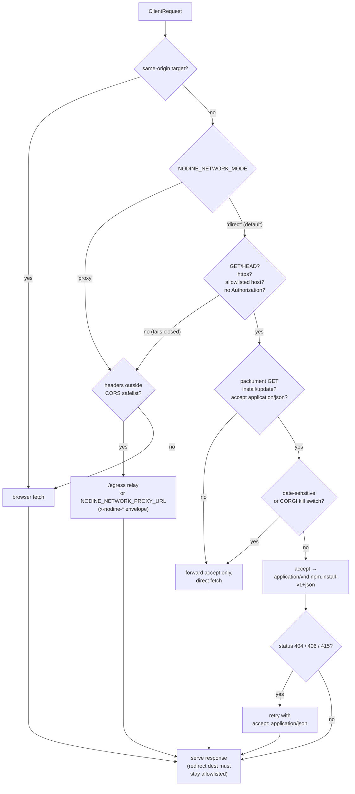

# npm, inside the browser

A process spawned in the Nodine container can run a real `npm install` against
the public registry — from the browser tab, with no server-side runtime
involved. This page documents how that works: what the shipped image contains,
how it is seeded into the kernel VFS at boot, what happens on the wire during an
install, how to choose between direct and proxy networking, and where the hard
limits are.

Everything below is grounded in the shipped sources:

| Source | Role |
| --- | --- |
| `scripts/build-runtime.mjs` | builds the derived runtime artifacts (`npm-seed-blob`, `npm-manifest.json`, `libsources.json`, `unpkg/`) from `vendor/` inputs |
| `scripts/build-shell-deps.cjs` | installs the pinned production dependency closure of `@yarnpkg/shell` |
| `scripts/patch-yarn-shell.cjs` | fixes `$?` handling in the vendored shell |
| `runtime/supervisor.mjs` | page-side boot, VFS seeding, process spawning, `baseEnv` |
| `runtime/runtime-worker.mjs` | per-process worker: the fetch-bridged network stack and the direct network adapter |

---

## 1. What ships in the image

The container's `/usr` tree is not assembled at boot. It is built offline by
`buildSeed()` in `scripts/build-runtime.mjs` and committed as one file,
`runtime/npm-seed-blob` (~18 MB, 18,789,780 bytes). `npm run build:runtime`
unpacks the vendored tarballs from `vendor/deps/` into a gitignored `.cache/`
and walks them into a flat file list, which is then packed into the blob.

### The `/usr` tree

| Location | Contents |
| --- | --- |
| `/usr/lib/node_modules/npm` | npm 12.2.2, unpacked from `vendor/deps/npm-12.2.2.tgz` |
| `/usr/lib/node_modules/shell` | `@yarnpkg/shell` 4.1.3 plus its pinned production dependency closure (see below) |
| `/usr/lib/node_modules/pako` | pako 2.1.0 |
| `/usr/lib/node_modules/@noble/hashes` | @noble/hashes 1.8.0, with a `noble-hashes` alias symlink |
| `/usr/bin/npm`, `/usr/bin/npx` | symlinks into `…/npm/bin/npm-cli.js` and `npx-cli.js` |
| `/usr/bin/node` | a 20-byte exec stub whose only line is `#!/usr/bin/env node` |
| `/bin/sh` | the shell stub from `vendor/sh-stub.cjs`; it executes command lines through the vendored `@yarnpkg/shell` |
| `/usr/bin/{ls,cat,echo,head,tail,grep,wc,touch,mkdir,rmdir,rm,cp,mv,find,which,env,chmod,true,false}` | the Nodine coreutils — each path is a copy of the multi-call source in `vendor/coreutils/coreutils.js` (argv[1] basename dispatch) |
| `/home/user/demo/` | two small demo files (`readme.md`, `notes.txt`) |

Three more packages — pako 2.1.0, @noble/hashes 1.8.0 and js-md5 0.8.3 — also
ship as ESM trees under `runtime/unpkg/{pako,noble,jsmd5}/`. The runtime worker
imports these directly by URL: zlib rides pako (synchronous inflate), the digest
implementations ride @noble/hashes (sha1/sha256/sha512) and js-md5. The build
rewrites `@noble/hashes` bare specifiers inside that tree to relative URLs.
pako and @noble/hashes appear in both places: once under `unpkg/` for the
worker itself, once under `/usr/lib/node_modules/` as global packages in the
container's image.

### The shell and its `$?` patches

The `@yarnpkg/shell` tarball ships without its dependencies, so
`scripts/build-shell-deps.cjs` installs the exact pinned production closure once
(from the public registry; the closure is committed inside the blob afterwards,
so neither publishing nor serving ever needs network access): tslib 2.9.1,
@yarnpkg/fslib 3.1.5, @yarnpkg/parsers 3.1.0, chalk 4.1.2, clipanion
4.0.0-rc.4, cross-spawn 7.0.6, fast-glob 3.3.3, micromatch 4.0.8 plus their
transitive graph.

`scripts/patch-yarn-shell.cjs` then applies two fixes that block `$?` support
(the patches are idempotent and re-applied after every fresh tarball unpack):

- `lib/index.js` initialized the `?` variable to the **number** `0`. The
  evaluator passes variables to `split()`, which calls `raw.match` — so the very
  first `$?` reference crashed with `TypeError: raw.match is not a function`.
  The patch initializes it as the string `'0'`.
- `lib/globUtils.js` ran the glob detector over the raw token, so the `?` inside
  a parameter reference (`a=$?`) classified the whole word as a glob pattern and
  `echo a=$?` died with `No matches found: "a=$?"`. POSIX sh treats `?` after
  `$` as a parameter name, never a glob character. The patch strips
  `$NAME`/`${NAME}` references before the scan; substituted *values* are still
  glob-checked afterwards, which is the correct place.

### The CSB1 blob format

`runtime/npm-seed-blob` is a single binary file in the "CSB1" format:

```
┌──────────┬───────────────┬──────────────────────┬──────────────────────┐
│ "CSB1"   │ u32le JSON len │ JSON file table      │ concatenated file     │
│ (4 bytes)│ (4 bytes)      │ {path,size,mode,type,│ bytes                 │
│          │                │  target?,off,len}    │                      │
└──────────┴───────────────┴──────────────────────┴──────────────────────┘
```

- an 8-byte header: the ASCII magic `CSB1` followed by the JSON length as a
  little-endian u32;
- a JSON file table — one entry per path with `{path, size, mode, type}`;
  `symlink` entries add `target`, `file` entries add `off`/`len` offsets into
  the byte area; `dir` entries carry neither;
- the concatenated file bytes, in table order.

The current blob holds 3,330 entries: 2,748 files, 577 directories, 5 symlinks.
`runtime/npm-manifest.json` is the same table without the byte area; it backs
the per-file fallback described next.

---

## 2. Seeding at boot

When `Container.boot()` runs (with `seedLibSources` at its default `true`),
`supervisor.seed()` materializes the image into the kernel VFS in one pass.

### One request

The supervisor fetches `npm-seed-blob` — resolved relative to the supervisor
module's own URL, so it works wherever the bundle is served — and checks the
`CSB1` magic. One request delivers the entire image; its cost is network time
only. It then walks the file table:

- `dir` entries → `mkdirP` (kernel `MKDIR`, tolerating `EEXIST`),
- `symlink` entries → kernel `SYMLINK` (target first, then link path),
- `file` entries → `blobView.slice(off, off + len)` → `kwriteFile`.

`kwriteFile` opens the target with `O_WRONLY | O_CREAT | O_TRUNC` (the create
mode pre-compensates the kernel's umask so 644/755 land exactly) and writes the
file in chunks of at most 8,128 bytes — the ABI's sync-payload cap — over the
kernel RPC, then closes the fd.

### Why `.slice`, not `.subarray`

Each file's bytes are extracted with `blobView.slice(e.off, e.off + e.len)`, and
the source comment records why this matters: `postMessage` structured-clones a
TypedArray **view** by copying its entire underlying buffer (V8 behavior).
Several thousand `subarray` views over the one ~18 MB blob would clone the
whole buffer once per file — the comment records the measured cost of that
naive approach at roughly 35 GB of memcpy and a 42-second seed. `slice()` copies
just that file's bytes into a fresh small buffer, so the total extra cost is
one ~18 MB pass.

### The per-file fallback

If the blob request fails, returns non-OK, or lacks the `CSB1` magic, `seed()`
falls back to fetching `npm-manifest.json` and pulling every file individually
through a `npm-file?p=<path>` endpoint, keeping an 8-wide prefetch pipeline
running so the wire stays busy. This path needs thousands of per-file HTTP round
trips, so it is markedly slower than the one-shot blob; it exists for hosts that
serve the image per-file instead of shipping the blob.

After the image lands, `seed()` writes a small demo workspace (`/project` with
`package.json`, `main.js`, `preview-demo.js`); `main.js` is the canonical
`npm install left-pad` demo referenced below.

---

## 3. `npm install left-pad`, end to end

The whole flow — resolution, download, unpack — happens inside the tab: the npm
process runs in its own worker, its network requests go through the browser's
own `fetch`, and the installed tree is written into the kernel VFS.

### Spawning npm

`container.spawn('npm', ['install', 'left-pad'])` composes the process
environment from the supervisor's `baseEnv` layered with `BootOptions.env` and
any per-spawn `options.env`, then resolves the executable:

1. `npm` has no `/`, so the supervisor searches `PATH` (`/usr/bin:/bin`) via
   kernel stat → `/usr/bin/npm`.
2. The symlink chain resolves (≤ 8 hops) to
   `/usr/lib/node_modules/npm/bin/npm-cli.js`.
3. Reading the first 128 bytes shows the `#!/usr/bin/env node` shebang, so the
   file is executed as a node script: a fresh `runtime-worker.mjs` worker boots
   with `entry = npm-cli.js`, `argv = ['install', 'left-pad']`.

### The environment npm sees

`baseEnv` (in `runtime/supervisor.mjs`) ships npm-specific defaults:

| Variable | Value | Why |
| --- | --- | --- |
| `npm_config_registry` | `https://registry.npmjs.org/` | the public registry |
| `npm_config_fetch_retries` | `2` | a transient network error retries instead of failing the install |
| `npm_config_loglevel` | `notice` | npm's own default — the progress line and the result summary, without per-request debug noise |
| `npm_config_audit` | `false` | skips the audit round trip: the bulk-advisories request is a POST whose CORS preflight the registry cannot answer from a browser, and it contributes nothing to the install |
| `npm_config_fund` | `false` | skips the funding lookup — one more registry round trip with no install value |
| `npm_config_maxsockets` | `8` | caps npm's connection fan-out to match the runtime's browser-side fetch gate; npm's wider default (15 sockets) times retries escalates into CDN throttling under burst |
| `HOME` / `PATH` / `SHELL` | `/home/user` / `/usr/bin:/bin` / `/bin/sh` | standard paths into the seeded image |

These are defaults, not locks: a host can override any of them through
`BootOptions.env` or per-spawn `options.env` (for example to point
`npm_config_registry` at a different host — see the allowlist caveat in
section 6).

### Resolution over the fetch-bridged network

Inside the process, npm resolves through Node's normal machinery — its `http`
and `https` modules are provided by the runtime's fetch bridge. The bridge
implements the `Agent` / `ClientRequest` / `IncomingMessage` surface on top of
the browser's `fetch`: `ClientRequest` buffers the request body, drops the
browser-forbidden headers (`host`, `connection`, `content-length`,
`transfer-encoding`, `upgrade`), performs the request, and wraps the `Response`
in a stream with backpressure. Responses are integrity-guarded: a
`content-length` body that ends short surfaces as a retryable `ECONNRESET`,
never as a truncated body that fails to parse. A browser-side semaphore sized
from `npm_config_maxsockets` (8) queues concurrent `fetch` calls, restoring
agent-socket semantics so requests queue instead of flooding the platform.

For allowlisted anonymous HTTPS requests the bridge skips any relay entirely
and lets the browser talk to the registry directly (section 4). During
`install`/`update`, npm asks for a full-metadata packument
(`accept: application/json`); the adapter rewrites that to the abbreviated
"corgi" packument (`accept: application/vnd.npm.install-v1+json`) — the
representation npm's resolver actually consumes — which is a fraction of the
size. If the registry answers 404, 406 or 415 to the substituted request, the
adapter retries once with the original accept, preserving npm's semantics.

### Tarball download and unpack

npm then GETs the tarball (`…/left-pad/-/left-pad-1.3.0.tgz`) over the same
bridge. Tarball responses arrive identity-encoded, so npm's integrity check
over the exact bytes it receives passes; the bridge streams the body to npm's
tar extractor, which inflates the archive (the runtime's zlib rides pako) and
writes the tree through the runtime's `fs` — every write landing in the kernel
VFS. `node_modules/left-pad/` now exists under the process's working
directory, alongside whatever the host mounted there.

### `require('left-pad')` works

A later `container.spawn('node', ['main.js'])` in the same directory resolves
`require('left-pad')` the way Node always does: walk `node_modules` upward from
the script's directory, find the package in the VFS, load it. Nothing about
the resolution is faked or intercepted — the seeded
`/project/main.js` demo does exactly this, printing `left-pad says: ------ab`
after the install.

### The whole flow



---

## 4. Direct vs proxy mode

Two environment knobs decide how the fetch bridge reaches registries; both are
read from the process environment, which means `BootOptions.env` reaches every
spawned process:

| Variable | Default | Meaning |
| --- | --- | --- |
| `NODINE_NETWORK_MODE` | `'direct'` | `'direct'` — the browser talks to allowlisted registries itself; `'proxy'` — requests that a browser cannot send cross-origin ride a host relay |
| `NODINE_NETWORK_ALLOWLIST` | `registry.npmjs.org` | comma-separated HTTPS hostnames the direct adapter may contact |
| `NODINE_NETWORK_PROXY_URL` | (unset) | replaces the built-in same-origin `/egress` relay base URL with a host-supplied one |
| `NODINE_DIRECT_CORGI` | (unset) | kill switch for the corgi substitution — see below |

### Direct mode (default)

For every cross-origin request the adapter asks, in order: is the method GET
or HEAD? Is the URL HTTPS? Is the host on the allowlist? Is there no
`Authorization` header? Any "no" and the request fails closed to the relay
path (in proxy mode that is where it belongs; on a direct-mode host without a
relay it fails, which is the intended containment). Direct requests forward
**only** preflight-safe headers — in practice `accept` — because the browser
substitutes its own `user-agent`/`accept-encoding` and npm's other headers
(`npm-command`, `pacote-*`, `npm-auth-type`, `npm-session`, `referer`) are not
CORS-safelisted. Redirects are followed by `fetch`, and the final destination
must still be allowlisted or the request fails with `ERR_UNSAFE_REDIRECT`.

Because direct mode never sends credentials, an authorized request (private or
scoped package registries) always fails closed to the relay — the adapter never
silently de-authenticates.

### Corgi substitution, and its kill switch

On a direct-mode packument GET during `npm install`/`npm update`, the adapter
rewrites `accept: application/json` to `application/vnd.npm.install-v1+json`.
Substitution is skipped — and the full-metadata request served as-is — when the
install is date-sensitive: npm's `before` / `min-release-age` options are
detected across `process.env`, `process.argv` and the `~/.npmrc` / project
`.npmrc` files, because an abbreviated packument cannot answer a
date-filtered resolution. Setting `NODINE_DIRECT_CORGI` to `off`, `0` or
`false` (case-insensitive) disables substitution outright — every packument
then rides the original full-metadata accept.

### Proxy mode (opt-in)

`Container.boot({ env: { NODINE_NETWORK_MODE: 'proxy' } })` opts the runtime
into routing the requests a browser cannot send cross-origin — anything with
non-safelisted headers such as npm's `npm-command`/`pacote-*` headers,
`Authorization`, or a non-simple `content-type` — through a **same-origin
`/egress` relay the host must serve**. The relay envelope carries the real
target in `x-nodine-url`, the real method in `x-nodine-method`, and the
full original header set in `x-nodine-headers`, so nothing is silently
de-authenticated or downgraded. A GET carrying a body becomes an envelope POST
(`fetch` cannot GET with a body); the relay forwards the real method. Hosts that
run their relay elsewhere set `NODINE_NETWORK_PROXY_URL` to its base URL.



---

## 5. The globalPaths graft (B26)

npm installs global packages into `/usr/lib/node_modules`. Node's
`Module._initPaths()`, however, seeds `Module.globalPaths` with only the
historical `$PREFIX/lib/node` layout — `/usr/lib/node_modules` is not among the
entries. That is a real-world divergence global-package resolvers trip over:
ecosystem code such as `@expo/require-utils` reads `node:module`'s
`globalPaths` expecting the npm global root to be listed, and fails to find
global packages when it is not.

The runtime closes the gap **at build time, in the vendored loader source**:
`buildLibsources()` in `scripts/build-runtime.mjs` grafts a few lines into the
`internal/modules/cjs/loader` source right after the `Module._initPaths();`
call, appending `/usr/lib/node_modules` to `Module.globalPaths` when it is not
already present. The grafted source is what ships inside
`runtime/libsources.json`, so every process worker boots Node's loader with the
npm global root already in `globalPaths` — no per-process patching, no runtime
hook. Because `require`'s lookup path consults `globalPaths`, global packages
in the image (`npm`, `pako`, `@noble/hashes`, …) resolve the way they would on
a real system with an npm prefix of `/usr`.

---

## 6. Constraints and honest limits

- **Allowlisted registries only.** Direct mode permits anonymous HTTPS GET/HEAD
  to hosts in `NODINE_NETWORK_ALLOWLIST`, which defaults to
  `registry.npmjs.org` alone. Pointing `npm_config_registry` (or `.npmrc`) at a
  different registry does nothing unless that host is added to the allowlist
  too.
- **No arbitrary egress.** A process inside the container cannot make the
  browser fetch an arbitrary host: non-allowlisted targets, non-GET/HEAD
  methods, plain HTTP and any credentialed request fail closed. A host must
  not expect the runtime to reach arbitrary APIs, Git remotes, or anything
  outside the (extended) allowlist. Methods like the `PUT` behind
  `npm publish` or authenticated access need proxy mode plus a relay.
- **Private and scoped registries need proxy mode.** Direct mode never sends
  `Authorization` (browsers cannot attach it cross-origin without a preflight
  the registry does not answer), so authenticated feeds only work through a
  host-served `/egress` relay — with the registry host added to the allowlist
  for any traffic that still qualifies for the direct path.
- **Audit and funding are off by default** (`npm_config_audit=false`,
  `npm_config_fund=false`) because their requests cannot be served to a browser
  in direct mode; re-enabling them via env requires a relay to carry the
  requests.
- **Proxy mode is a host commitment.** Setting
  `NODINE_NETWORK_MODE='proxy'` without serving the same-origin `/egress`
  relay (or setting `NODINE_NETWORK_PROXY_URL` to one) makes every
  non-safelisted request fail.
- **`pnpm` is not part of the shipped image** — `/usr/lib/node_modules` ships
  npm only.
