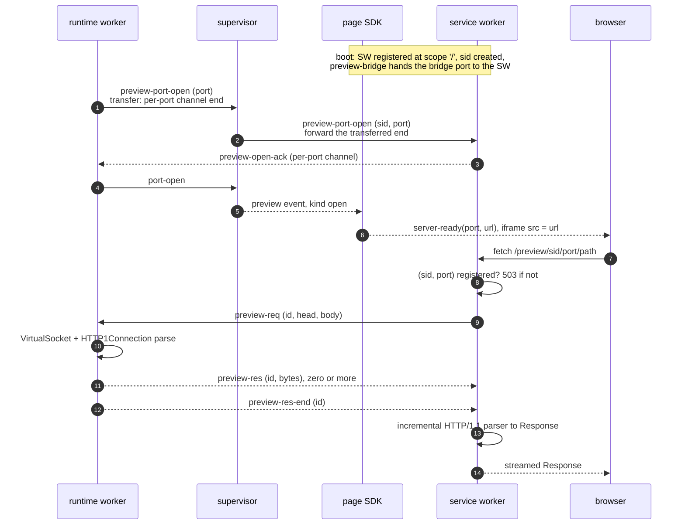
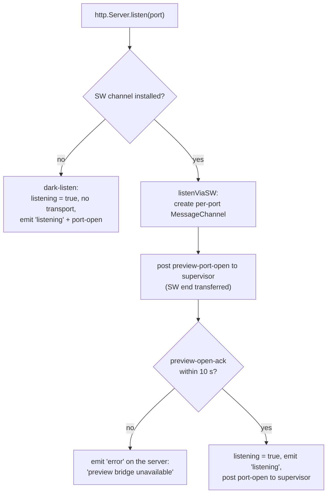

# The preview system: dev servers with real URLs

When a program running inside a `Container` calls `http.Server.listen()`, Nodine
bridges that listener onto a same-origin service worker, so the server gets a
real URL under the app's own origin: `/preview/<sid>/<port>/<path>`. A dev
server started with `npm start` becomes previewable in an iframe with no host
server, external proxy, or tunnel involved — inbound HTTP is entirely browser
plumbing, and the app's origin is the only origin involved.

Three pieces cooperate:

| Piece | Where | Role |
| --- | --- | --- |
| Preview gateway | `runtime/sw-nodine.js` | Service worker registered at scope `/`. Owns the session/port registry, serves every `/preview/…` fetch, rewrites root-relative subresources. |
| Session broker | `runtime/supervisor.mjs` (`initPreviewSW`, `onChannelMsg`, `previewPortOpen/Close`) | Holds the session id, forwards per-port channels to the SW, keeps the port → owning-process registry, raises preview events to the page. |
| Server transport | `runtime/runtime-worker.mjs` (`PortServer`, `listenViaSW`, `onPreviewChanMsg`) | Implements `http.Server.listen()` inside each process worker: registers the port with the SW or dark-listens, then serves each request through a real HTTP/1.1 parser. |

The SDK side (`src/container.ts`, `initPreviewBridge`) wires everything up at
boot and maps runtime events onto the public `Container` API.

## 1. What the user sees

```js
import { Container } from 'nodine';

const container = await Container.boot(); // preview is enabled by default

container.on('server-ready', (port, url) => {
  // url is a same-origin path, e.g. /preview/<sid>/<port>/
  frame.src = url;
});
container.on('port', (port, kind, url) => {
  console.log(`port ${port} ${kind}: ${url}`); // kind is 'open' or 'close'
});

await container.spawn('npm', ['start']);
```

- **`server-ready`** fires with `(port, url)` once the service worker has
  acknowledged the port registration — at that point the URL is live and safe
  to point an iframe at.
- **`port`** fires with `(port, kind, url)` for both openings and closings; it
  is the superset of `server-ready`. Close events fire when the in-runtime
  server calls `close()` and when the process that owned the port exits.
- **`container.previewUrl(port)`** returns the URL on demand:
  `/preview/<sid>/<port>/`. Without a live preview session (the bridge never
  established) it returns `/preview/unavailable/<port>/`, which serves a 503.

The URL scheme is:

```
/preview/<sid>/<port>/<path>?<query>
```

- `<sid>` is the session id, a `crypto.randomUUID()` generated once per page
  boot and owned by the page.
- `<port>` is the virtual port the in-runtime server passed to `listen()`.
- `<path>` and the query are forwarded verbatim; the server sees its own
  paths.

Scoping is strict: the SW keeps a `Map(sid → Map(port → MessagePort))` and a
fetch is served **only** if the live page session registered that port. A
request for an unregistered `(sid, port)` gets a plain-text
`503 nodine preview: port <port> is not open in session <sid-prefix>…`
response naming the port and a truncated session id. There is no open proxy:
the SW never forwards anything to the network, one session cannot reach
another session's ports, and paths outside the preview scheme pass through
untouched.

## 2. Registration and session setup

`Container.boot()` runs `initPreviewBridge()` unless `enablePreview: false`
(it defaults to true). The steps, all inside that function:

1. **Secure context.** Service workers require https or localhost; the boot
   environment check includes `'serviceWorker' in navigator`, and
   registration simply fails on non-secure origins.
2. **Script URL.** The SW script is resolved relative to the runtime module
   URL (`sw-nodine.js` next to `supervisor.mjs`), not the page base —
   so the runtime bundle can live in any directory the host serves.
3. **Registration at scope `/`.** `navigator.serviceWorker.register(swUrl,
   { scope: '/' })`, then `await navigator.serviceWorker.ready`, then a short
   poll (up to 50 × 100 ms) for an active worker instance. The scope must be
   `/` because `/preview/…` URLs are origin-rooted — the SW has to intercept
   them. A script may only claim scope `/` if it is served from the origin
   root **or** the server sends `Service-Worker-Allowed: /` with it. The
   official Vite plugin (`nodine/vite`) sends that header for every file it
   serves from the runtime bundle, so the default `/nodine` path works out of
   the box; on a static host, either serve the bundle at the origin root or
   add the header for `sw-nodine.js`.
4. **Session claim.** The SW itself installs with `skipWaiting()` and, on
   activate, `clients.claim()`. The SDK then generates
   `sid = crypto.randomUUID()`, creates a `MessageChannel`, hands one end to
   the supervisor (`supervisor.initPreviewSW(sid, port1)`) and transfers the
   other end to the SW with
   `{ type: 'preview-bridge', sid, forwardErrors }` posted on
   `navigator.serviceWorker.controller`. From then on, all session control
   traffic between supervisor and SW flows on that bridge port. The SW adopts
   the session: if a *different* session owned the bridge, every port it had
   registered is closed and cleared — one live bridge session per SW, and the
   newest page load wins. `forwardErrors` records the session's
   error-forwarding mode (section 6).
5. **Event hooks.** The SDK installs `supervisor.onPreviewEvent` and
   `supervisor.onPreviewMessage`, which map runtime events onto
   `server-ready`, `port` and `preview-message`.

**When registration fails** — no service worker support, a rejected
`register()` call, or no active instance after the poll — everything is
best-effort: boot continues normally, `previewSid` stays unset, workers spawn
without a preview channel, `listen()` dark-listens (section 4), and preview
events never fire. `previewUrl()` returns the `/preview/unavailable/…` path.
`Container.teardown()` posts `{ type: 'preview-bridge-end', sid }` so the SW
drops the session's registrations and closes the bridge port.

## 3. Message topology and the per-port channel protocol

There are three message planes: page → SW (the controller), supervisor ↔ SW
(the bridge port), and worker ↔ SW (one dedicated `MessagePort` channel per
listened port). Note that messages the supervisor forwards after the bridge
handshake arrive **on the bridge port's `message` event**, never on the SW's
global listener; the global listener only handles `preview-bridge`,
`preview-bridge-end`, and the namespaced hook protocol of section 6.

| Message | From → to | Carried on | Payload / transfer |
| --- | --- | --- | --- |
| `preview-bridge` | page → SW | controller postMessage | `sid`, `forwardErrors`; transfers the SW-side end of the bridge port |
| `preview-bridge-end` | page → SW | controller postMessage | session teardown (from `teardown()`) |
| `preview-worker-chan` | supervisor → SW | bridge port | `sid`; transfers one end of a fresh per-worker channel (created at spawn) |
| `preview-port-open` | worker → supervisor | process channel | `port`; transfers the SW-side end of a fresh per-port channel |
| `preview-port-open` | supervisor → SW | bridge port | `sid`, `port`; the transferred channel end is forwarded |
| `preview-open-ack` | SW → worker | per-port channel | registration confirmed; `listen()` waits up to 10 s for it |
| `preview-req` | SW → worker | per-port channel | `id`, `head` (serialized HTTP/1.1 request), optional `body` |
| `preview-res` | worker → SW | per-port channel | `id`, `bytes` — **cloned, never transferred** |
| `preview-res-end` / `preview-res-err` | worker → SW | per-port channel | response finished / response failed |
| `preview-port-close` | worker → supervisor → SW | process channel + bridge port | drops the `(sid, port)` registration |
| `port-open` / `port-close` | worker → supervisor | worker postMessage | runtime event; the supervisor raises the SDK `server-ready`/`port` events from it |
| `preview-error` | SW → supervisor | bridge port | a validated error event from a preview document (section 6) |

Two fine points:

- **Bytes are cloned, not transferred.** Response buffers can be views into
  the kernel's shared memory; transferring them would detach that memory. The
  structured clone of every `preview-res` message is what makes the bridge
  safe to run on top of the shared-memory runtime.
- **The per-worker channel is a control line, not a data line.** Every
  spawned worker gets its own channel to the SW at spawn time
  (`preview-worker-chan`); the SW keeps it alive but routes no request traffic
  over it — requests always use per-port channels. The worker listens on its
  end for `preview-port-gone`, a teardown notice that closes any server still
  listening on that port. The SW also answers a `preview-open-req` on a
  per-port channel with an ack — an alternate registration message in the
  wire protocol; the `listen()` path described here registers through the
  supervisor-forwarded `preview-port-open`.

### The life of a preview request



Step by step:

1. At spawn, every worker gets its per-worker channel end in its init
   message and installs it at module top — before `main()` runs — so a
   `listen()` racing the init path still finds it.
2. `listen()` creates a fresh `MessageChannel` for the port, keeps its end,
   and transfers the other end to the supervisor (`preview-port-open` on the
   process channel). The supervisor forwards it to the SW with the session id
   (same message type, on the bridge port). If the supervisor has no bridge,
   it closes the transferred end immediately — the worker's 10-second ack
   timeout then turns into a listen error.
3. The SW registers `(sid, port) → channel` and posts `preview-open-ack`
   back along it. `MessagePort` queues survive transfer, so the ack is
   delivered even if it is posted before the worker attaches its handler.
4. On ack the worker emits `'listening'` and posts `port-open` to the
   supervisor, which raises the SDK `server-ready` / `port` events. Without
   an ack within 10 s, the worker drops the record, closes the channel, and
   emits `'error'` on the server with
   `'preview bridge unavailable (no service worker?)'`.
5. Every browser request becomes one `preview-req`. The SW serializes an
   HTTP/1.1 request head: request line, a synthetic `host: preview`, all
   request headers except the hop-by-hop set (`host`, `content-length`,
   `connection`, `transfer-encoding`, `keep-alive`, `upgrade`), and a
   `content-length` computed from the body. The body is read with
   `request.arrayBuffer()` for methods other than GET and HEAD.
6. Responses return as `preview-res` byte messages terminated by
   `preview-res-end` (or `preview-res-err`). The SW's own incremental
   HTTP/1.1 parser turns them into a streaming `Response`: content-length and
   chunked framing, read-until-close fallback, hop-by-hop headers stripped,
   `content-encoding` passed through untouched so the browser decodes the
   exact bytes. A response head larger than 256 KiB or a bad chunk framing
   fails the response.
7. The parser adds `Cross-Origin-Resource-Policy: same-origin`,
   `Cross-Origin-Opener-Policy: same-origin` and
   `Cross-Origin-Embedder-Policy: require-corp` when the server did not send
   its own copies: preview responses stay embeddable under the host page's
   COEP while remaining isolated from the host window. An application's own
   copies win.
8. Failure surfaces: no registration → 503 text; the worker closes before
   headers → 502 text; a response error → 502 text; a request-serialization
   failure → 502 text; headers not received within 30 s → the SW fails the
   fetch outright (a hung in-runtime server cannot hang the tab).
9. `close()` posts `preview-port-close` (worker → supervisor → SW) and the
   SW drops the registration — later fetches get the 503 text response.
   Process exit does the same for every port the process owned.

## 4. Inside the worker: listen() dispatch and per-request parsing

`PortServer` is the class `http.Server` maps onto inside the runtime. Its
`listen()` accepts the usual Node argument shapes (port, host, backlog,
options object, callback) and dispatches exactly once:



- **SW bridge first.** If the worker has an installed SW channel port
  (`listenViaSW` returns true), the listen proceeds through the per-port
  registration of section 3. The bridge is the only real transport — there is
  no host tunnel.
- **Dark-listen fallback.** With no SW channel at all, `listen()` still
  *succeeds*: the port is remembered, `listening` becomes true, `'listening'`
  is emitted and `port-open` is posted to the supervisor — but no external
  connection can ever arrive, and the page sees no preview events because no
  bridge session exists. Dev servers (Vite, webpack serve, Expo/Metro) still
  reach their startup banner and interactive prompts, which is the
  terminal-session contract. The same applies on non-secure origins, where
  SW registration cannot succeed.
- Preview ports are active handles: a process whose only activity is a
  listening preview server does not exit — the event-loop quit decision
  counts `previewPorts`, so the server survives between the `server-ready`
  event and the first fetch.
- Only servers created through `node:http` are bridged. A raw `net.Server`
  bind succeeds by recording the endpoint (so real Node code proceeds
  through `bind`/`listen`), but its connections are never surfaced; nothing
  serves them.

**Per request** (`onPreviewChanMsg`): each `preview-req` becomes one
connection. The worker decodes the head string, concatenates it with the
optional body, and runs the bytes through the real HTTP machinery:

1. A `VirtualSocket` is created for the request (`remoteAddress`
   `127.0.0.1`, the preview port as `remotePort`), plus one `HTTP1Connection`
   as the parser. The SW request id doubles as the connection id; duplicate
   deliveries are ignored.
2. Response capture is wired **before** the server is notified: the socket's
   `_send` is overridden per instance to post `preview-res` (a clone, per
   section 3), and `end`/`destroy` are patched to finish the response — so a
   handler that calls `res.end()` synchronously in the same tick is still
   captured.
3. The server receives a genuine `'connection'` emit and the parser gets the
   bytes, which drives the same request path a real socket would: URL
   parsing, headers, body streaming, the `'request'` handler.
4. Completion is one-request-per-connection on the bridge: a
   `Connection: close` response ends via the patched `sock.end`, keep-alive
   responses end via a `'finish'` patch on the `ServerResponse`, and a parse
   error posts `preview-res-err`.
5. `close()` (via `unlistenViaSW`) destroys live connection sockets, closes
   the per-port channel, posts `preview-port-close`, and posts `port-close`
   to the supervisor, which raises the SDK close event.

## 5. Root-relative subresource rewriting

A preview document at `/preview/<sid>/<port>/` that references `/favicon.ico`
or calls `fetch('/api/x')` produces an origin-rooted request — outside the
preview prefix. A subdomain-based preview gets this rewriting for free because
relative URLs resolve against the preview origin; here the SW reimplements it
with client hints:

- For every `/preview/…` fetch it serves, the SW records
  `event.resultingClientId → { sid, port }` — the client (document or worker)
  that consumes the response is bound to the preview it came from.
- A later fetch whose `resultingClientId` (falling back to `clientId`) has a
  hint, and whose path does **not** already match the preview pattern, is
  reinterpreted: the SW serves it under the hint's `(sid, port)` with the
  original path and query.
- So the preview document's `/favicon.ico` request is served by the same
  in-runtime server, as if it were
  `/preview/<sid>/<port>/favicon.ico`.

The rewrite only applies to same-origin, non-preview paths from preview
clients; every other request passes through untouched.

## 6. Preview error forwarding

Boot option `forwardPreviewErrors` controls what the session captures from
preview documents. It rides the `preview-bridge` message as the session-wide
mode:

- `true` → `'all'`: uncaught exceptions, unhandled rejections, **and**
  `console.error` calls.
- `'exceptions-only'` → `'exceptions'`: uncaught exceptions and unhandled
  rejections only.
- `false` / omitted → disabled: no injection at all (the default; hosts opt
  in).

**Injection.** For `text/html` responses of a session with a mode set, the SW
streams the body, buffers only until `</head>` is seen (up to a 256 KiB cap),
and injects a capture script immediately before it — so the hook runs before
any page script. The `content-length` header is dropped (the body grows; a
short body would be a network error). Non-HTML documents pass through
untouched, and a document rewritten in place by the preview app itself (via
`document.open`) is not re-injected.

**The capture script** binds `window.onerror` and `unhandledrejection` and,
in `'all'` mode, wraps `console.error`. Its session binding (sid, port, mode)
rides as `data-*` attributes on the injected `<script>` tag, and reports go
via `postMessage` to `navigator.serviceWorker.controller` under the
namespaced protocol key `__nodine_preview`. Every handler is guarded: an
error inside the capture never throws into the page, and the `console.error`
wrap blocks re-entrancy (a `console.error` issued while forwarding is not
re-forwarded).

**Validation and delivery.** The SW drops anything that is not from the
current bridge session, a registered port, and a known kind (`console` only in
`'all'` mode), caps all strings, and strips the `Uncaught ` prefix Chromium
adds to error events. Valid events are posted to the supervisor on the
bridge port as `{ type: 'preview-error', sid, port, kind, message, pathname,
search, hash, … }`. The SDK maps them to `preview-message` events:

- `PREVIEW_UNCAUGHT_EXCEPTION` — `message`, `stack`, plus
  `filename`/`line`/`column` where the browser provides them,
- `PREVIEW_UNHANDLED_REJECTION` — `message`, `stack`,
- `PREVIEW_CONSOLE_ERROR` — `message`,

each carrying `previewId` (the session id), `port`, `pathname`, `search` and
`hash`. Malformed or cross-session payloads are dropped before any host
listener can see them. Two caveats: a preview page whose CSP forbids inline
scripts silently disables the hook, and a cross-origin iframe has its own
controller — its documents' errors cannot reach this gateway.

## 7. Limitations

- **No WebSocket pass-through.** Service workers cannot intercept WebSocket
  upgrades; the preview gateway is HTTP-only. A server that attempts a 101
  protocol switch has its response replaced with
  `501 nodine preview: WebSocket/protocol upgrades are not supported (the
  preview gateway is HTTP-only)`.
- **One live bridge session per service worker.** A fresh page load claims
  the bridge and clears stale registrations. Two simultaneously live tabs
  cannot both serve previews — the newest load wins.
- **`listen(0)` is unsupported.** Ephemeral-port assignment is not bridged;
  pass an explicit port.
- **No client-abort propagation.** If the browser cancels a preview fetch
  mid-response, the SW stops streaming, but the in-runtime server is never
  notified — it finishes writing its response.
- **HTTP only, and only through `node:http`.** Raw `net.Server` binds succeed
  (the endpoint is recorded so real Node code proceeds) but no connection is
  ever surfaced on them.
- **No service worker on non-secure origins.** On plain http (other than
  localhost) registration fails gracefully and `listen()` dark-listens
  inside the runtime: the container works, preview URLs never go live.
- **Response-head watchdog.** If the in-runtime server does not send headers
  within 30 s, the SW fails the fetch.
